# Multiplex Amplicon Toolkit

[](https://github.com/AHumanBrain/my_amplicon_project/actions/workflows/ci.yml)

A vendor-agnostic design tool for **custom-panel multiplex PCR** on DNA or RNA targets. You decide what to target; the tool designs and screens primers, packs them into pools, and analyses the sequencing so coverage feeds back into pool rebalancing. Primers are ordinary oligos with truncated Illumina tails (P5 forward, P7 reverse), orderable from any vendor. **Everything is in silico** (nothing wet-lab validated; the analysis has been run on one real public dataset).

```mermaid
%%{init: {"theme":"base","themeVariables":{"fontFamily":"Inter, system-ui, -apple-system, Segoe UI, sans-serif","fontSize":"15px","background":"#fcfcfb","primaryColor":"#cde2fb","primaryBorderColor":"#2a78d6","primaryTextColor":"#0b0b0b","secondaryColor":"#d3f1e5","tertiaryColor":"#fde1d6","lineColor":"#52514e","textColor":"#0b0b0b","clusterBkg":"#fcfcfb","clusterBorder":"#e4e3df","edgeLabelBackground":"#fcfcfb"},"flowchart":{"curve":"basis","nodeSpacing":30,"rankSpacing":42,"padding":12}}}%%
flowchart LR
    T["Targets TSV<br/>+ reference"]:::step --> D["design.py<br/>primers · pools"]:::step
    D --> O["order.csv<br/>pool BEDs<br/>manifest"]:::out
    O -. "order · PCR · sequence" .-> R["FASTQ"]:::plain
    R --> A["analyze.py<br/>trim · align · coverage"]:::step
    O --> A
    A --> F["report<br/>feedback JSON"]:::out
    F -- "rebalance · redesign" --> D
    classDef step fill:#cde2fb,stroke:#2a78d6,stroke-width:1.6px,color:#0b0b0b
    classDef out fill:#d3f1e5,stroke:#1baf7a,stroke-width:1.6px,color:#0b0b0b
    classDef warn fill:#fde1d6,stroke:#eb6834,stroke-width:1.6px,color:#0b0b0b
    classDef plain fill:#fcfcfb,stroke:#52514e,stroke-width:1.2px,color:#0b0b0b
```

*Blue: steps · green: files you get · orange: decisions and limits.*

## At a glance: a whole-genome SARS-CoV-2 panel

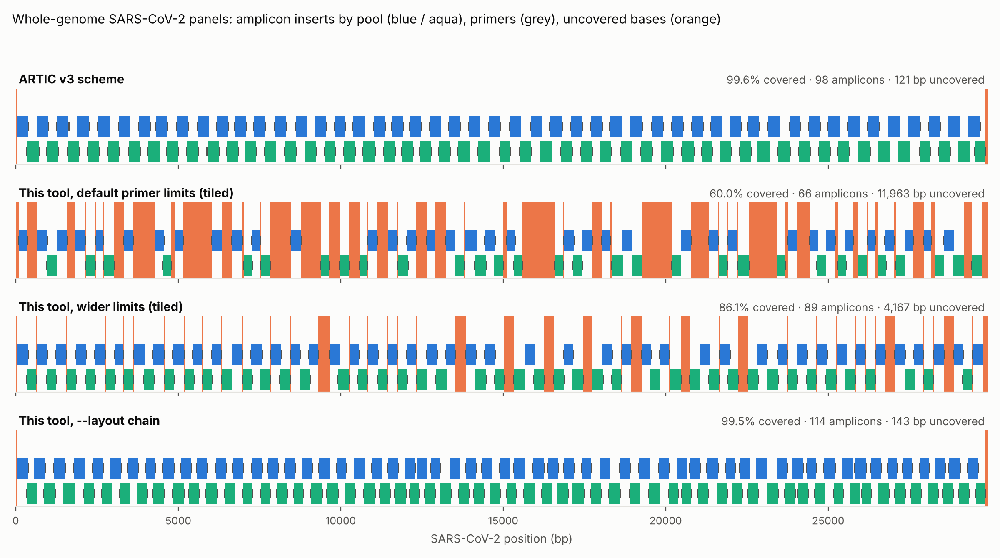

Share of the 29,903 bp genome inside some amplicon insert once primers are trimmed (predicted from the design alone). The tool's three modes, against the real ARTIC v3 scheme:

| Design | Genome covered | Amplicons (pools) | Notes |
|---|---|---|---|
| ARTIC v3 scheme (reference point) | 99.6% | 98 (2) | 13% of bases covered twice |
| This tool, default primer limits, `tiled` | 60.0% | 66 of 99 tiles | 19-21 nt primers cannot be placed on a 38% GC genome |
| This tool, wider primer limits (`panel.example.toml`), `tiled` | 86.1% | 89 of 99 tiles | failed tiles: every candidate dimerises with its pool; neighbours barely overlap |
| **This tool, `--layout chain`** | **99.5%** | 114 (2) | 143 bp uncovered (117 at the genome ends); 19% of bases covered twice |

## Quick start

```bash
micromamba create -n amplicon_pipeline -f conda-linux-64.lock    # exact versions; or environment.yml
micromamba activate amplicon_pipeline

python design.py --project panel.example.toml                    # SARS-CoV-2, 99 tiles, ~2.5 min -> 2 pools
python design.py --project panel.example.toml --layout chain \
    --targets design/targets/sars2_region.tsv                    # whole genome, chained: several minutes (5-6 measured)
python scripts/design_viewer.py --prefix design/output/sars2_demo \
    --reference examples/sars2/NC_045512.2.fa --outdir panel_view # open panel_view/specificity.html

# after sequencing one pool:
python analysis/analyze.py --reads "raw_data/S_R{1,2}.fastq.gz" --genome examples/sars2/NC_045512.2.fa \
    --bed design/output/sars2_demo_pool_1.bed \
    --primers design/output/sars2_demo_pool_1_trimming.fasta --outdir results
python design.py --project panel.example.toml --feedback results/S/S_balancing_feedback.json
```

A project file (`panel.example.toml`) holds the options; command-line flags override it. Every design run writes `<prefix>_manifest.json`. `AGENTS.md` is the operating guide for AI assistants. **SARS-CoV-2 (30 kb) is the development and test genome**: `examples/sars2/` holds the reference and the ARTIC v3 scheme, `design/targets/sars2_*.tsv` the target sets. E. coli (`common_refs/`) is kept for scale tests and the plexity study.

## Targets

One TSV row per target: either a region (`reference`, `start`, `end`, 1-based inclusive) or a raw `sequence`. The tool never chooses targets; pick regions that are unique in your genome (repeat-derived regions fail by design).

| Column | Meaning |
|---|---|
| `name` | unique target name |
| `strand` | `+` (default) or `-`: sense strand. Design runs on the sense strand; the antisense primer is the RT primer for stranded RNA |
| `junctions` | a primer must overlap one of these joins (position of the first base after the join) |
| `span` · `avoid` | the amplicon must contain a range · no primer may overlap a range |
| `amplicon_min/max` · `max_hits` | per-target size range · allowed exact hits per primer per database |

**RNA:** design on the transcript and screen against transcriptome *and* genome (`--specificity-fasta transcripts.fa genome.fa`). The report then shows genomic amplification: on a synthetic 3-exon gene, a junction-spanning primer pair has no genomic product, while the unconstrained pair predicts a same-size one (`python scripts/make_rna_example.py`).

Ready-made sets in `design/targets/`: `sars2_tiles.tsv` (99 overlapping tiles), `sars2_region.tsv` (the whole genome as one region for `--layout chain`), `sars2_genes.tsv` (10 ORFs), and E. coli `ecoli_spread_{50,100,250}.tsv` (genome-wide, evenly spaced; `scripts/make_ecoli_targets.py` regenerates them).

## Design

```mermaid
%%{init: {"theme":"base","themeVariables":{"fontFamily":"Inter, system-ui, -apple-system, Segoe UI, sans-serif","fontSize":"15px","background":"#fcfcfb","primaryColor":"#cde2fb","primaryBorderColor":"#2a78d6","primaryTextColor":"#0b0b0b","secondaryColor":"#d3f1e5","tertiaryColor":"#fde1d6","lineColor":"#52514e","textColor":"#0b0b0b","clusterBkg":"#fcfcfb","clusterBorder":"#e4e3df","edgeLabelBackground":"#fcfcfb"},"flowchart":{"curve":"basis","nodeSpacing":30,"rankSpacing":42,"padding":12}}}%%
flowchart LR
    S["target +<br/>constraints"]:::step --> U["repeat screen<br/>(k-mer counts)"]:::step
    U --> P["primer3<br/>candidates"]:::step
    P --> B["BLAST per<br/>database"]:::step
    B --> X["dimer and<br/>product filters"]:::step
    X --> L(["layout"]):::warn
    L --> O["pools · order.csv"]:::out
    classDef step fill:#cde2fb,stroke:#2a78d6,stroke-width:1.6px,color:#0b0b0b
    classDef out fill:#d3f1e5,stroke:#1baf7a,stroke-width:1.6px,color:#0b0b0b
    classDef warn fill:#fde1d6,stroke:#eb6834,stroke-width:1.6px,color:#0b0b0b
    classDef plain fill:#fcfcfb,stroke:#52514e,stroke-width:1.2px,color:#0b0b0b
```

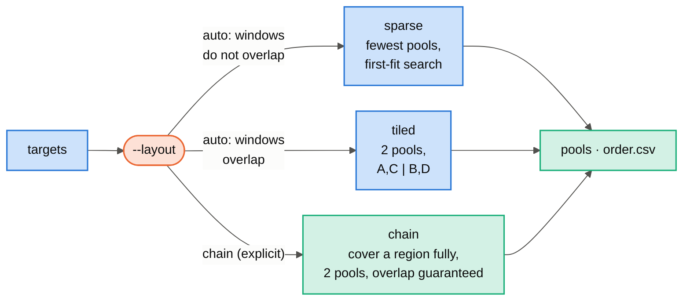

| | sparse | tiled | chain |
|---|---|---|---|
| Each target row is | one amplicon | one amplicon window | a region to cover completely |
| Pools | fewest compatible (`--max-pools N` caps it) | at most 2, alternating by position | 2, alternating along the chain |
| Cross-target product block | facing primers closer than 1000 bp | closer than the max amplicon size | closer than the max amplicon size |
| Picked by `--layout auto` | when windows do not overlap | when windows overlap | never (explicit) |
| Fails when | targets are left over under `--max-pools` | a target has no compatible pair in its pool | no compatible candidate bridges a stretch (listed as uncovered) |

**Chain layout.** Tiled placement leaves amplicons anywhere inside fixed windows, so neighbours can barely overlap and one lost amplicon opens a hole. `--layout chain` instead builds a pool of candidate amplicons from sliding windows (`--chain-step`, default 60 bp), then walks the region choosing amplicons so that neighbouring **inserts** (amplicon minus primers) overlap by at least `--chain-overlap` bp (default 10), alternating pools and requiring each amplicon to be dimer- and product-compatible with its pool. It backtracks when a choice dead-ends; a stretch it cannot bridge is recorded as uncovered and the chain restarts after it. Rows must be regions (no junctions, span, avoid, minus strand). Solver: `core/chain.py`.

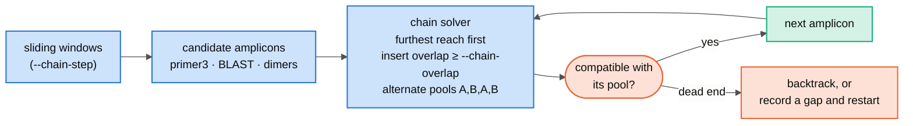

Tiled and chain runs report bases left uncovered after primer trimming (`<prefix>_tiling_gaps.tsv`).

**Thermodynamics:** KAPA HiFi conditions (2.5 mM Mg²⁺, 1.2 mM dNTP) on every primer3 call; primer 19-21 nt, 40-60% GC, Tm 59-61 °C by default (`--primer-min-size/-max-size`, `--primer-min-gc/-max-gc`, `--primer-min-tm/-max-tm`, or a `[primers]` section; AT-rich templates need wider limits, see Verified); dimer limits self −9, heterodimer −8, 3′ end −6 kcal/mol (`--max-*-dg`).

**Outputs** (`--output-prefix`): `_order.csv` (pool, name, sequence, role), `_pool_N.csv` (per pair, with hit counts and `predicted_products`), `_pool_N.bed`, `_pool_N_trimming.fasta`, `_manifest.json`, and `_failed_targets.txt` when relevant.

**Key flags:** `--layout`, `--max-pools`, `--max-hits`, `--amplicon-min/max`, `--primer-*` limits, `--max-cross-product`, `--chain-step/--chain-overlap`, `--fwd-tail/--rev-tail/--no-tails`, `--seed` (same inputs + seed = identical output), `--rescue` (shift the window of unconstrained region targets), `--uniqueness-screen`.

**Repeat screen:** before primer design, `--uniqueness-screen` (default `auto`) counts every k-mer (19, or the minimum primer size if smaller) of each target across the specificity FASTA(s) and fails targets where no pair of genome-unique primer sites can fit the amplicon range, with the reason. It never rejects what the full search would accept on the human test below (0 of 79 designed regions rejected) but it is a pre-filter: it caught 12 of the 21 repeat regions that failed, the other 9 fail later in the normal search. `auto` runs it for references up to about 500 Mb (seconds); for a human-size genome it takes minutes, so use `--uniqueness-screen on`. Targets eligible for `--rescue` and runs with `--force-multiprime` skip it.

**Inspect specificity:** `scripts/design_viewer.py` writes a self-contained `specificity.html` plus IGV-loadable BED tracks (untested in IGV desktop). It lists 3′-anchored near-match priming sites (≥ 16 aligned bp, ≤ 1 mismatch) that exact-hit screening cannot see.

## Analysis

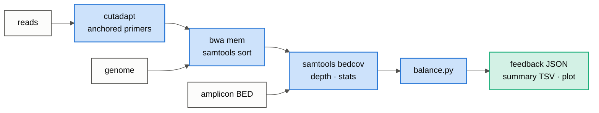

`analysis/analyze.py` needs only `cutadapt`, `bwa`, `samtools`, `numpy` and `matplotlib`. One run per pool; `{1,2}` in `--reads` marks the read number. Reads begin at the primer, so primers are matched anchored at the 5′ end (R1 forward, R2 reverse, which is what the tailed P5/P7 primers give) and unmatched reads are discarded; if none match, the run stops with an error. If your library starts reads at either end of the amplicon (ligation or tagmentation preps), add `--either-orientation`; on the real ARTIC run below the default kept 40% of pairs and this flag 80%.

Metrics: mean target coverage, on-target base %, fold-80 (mean ÷ 20th percentile of target-base depth; n/a when that percentile is 0), and % of amplicons above 0.2× the mean. On a 21-amplicon panel these reproduce the earlier Picard-based pipeline exactly, in 6 seconds instead of 1½ minutes. Output per sample in `<outdir>/<sample>/`: sorted BAM, `target_coverage.tsv`, `<sample>_balancing_feedback.json`, `_target_summary.tsv`, `_uniformity.png`, `_coverage_track.png`, `_summary.json` (metrics plus provenance).

Two plots are written per sample: normalized coverage per amplicon (`_uniformity.png`) and coverage along the genome with the amplicon layout underneath (`_coverage_track.png`).

**Real reads** (public MiSeq ARTIC v3 run, 98 amplicons; fold-80 5.6, 91.8% of amplicons above 0.2× the mean):

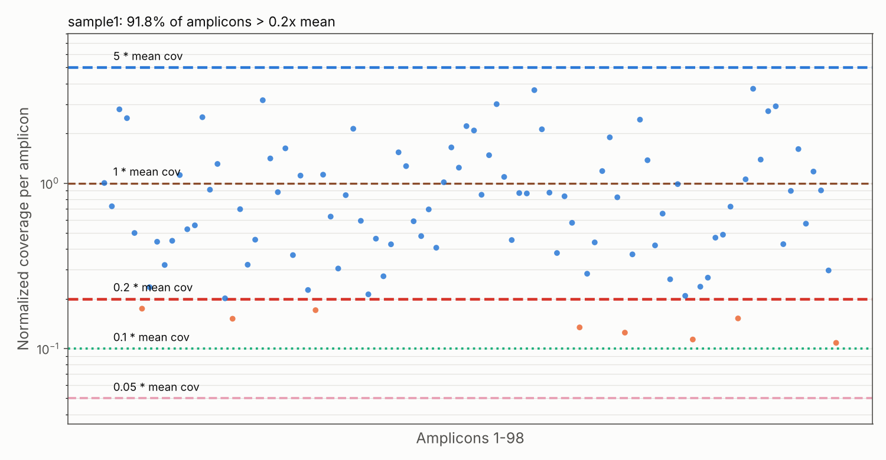

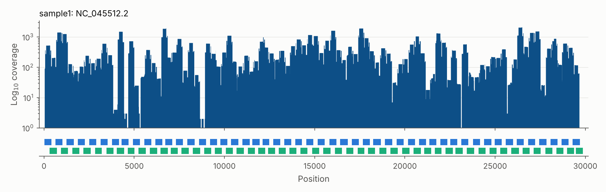

**Simulated reads for this tool's `--layout chain` design** (both pools together, 114 amplicons; fold-80 3.3). This is **simulated, not a prediction of yield**: the spread between amplicons is drawn from a log-normal calibrated to the real run's spread (`generate_simulated_fastq.py --lognormal-sigma 0.87`), so the plots show what the analysis looks like on a design of this size, and the two small internal gaps the design reports (about 13,070 and 23,100) show as dips:

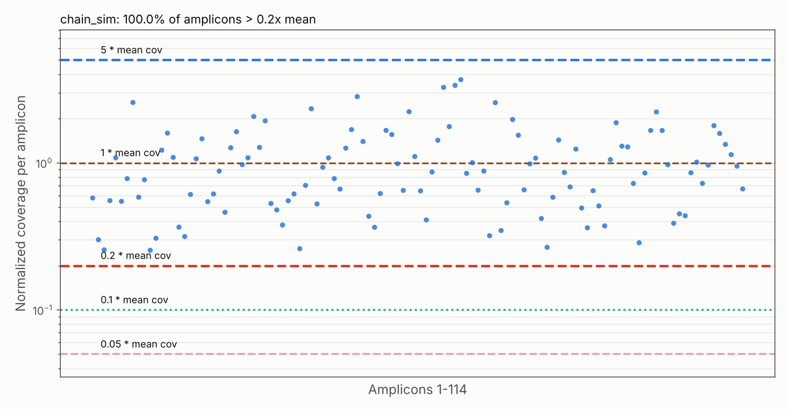

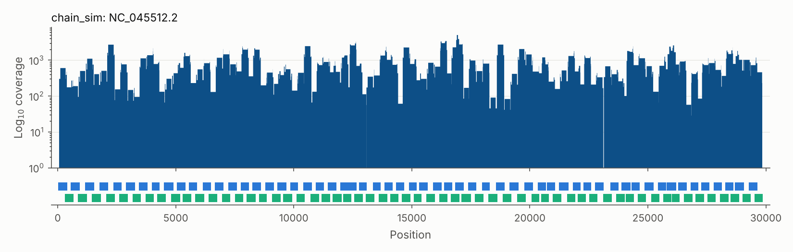

There is no variant calling. Amplicon reads share start positions, so over 99% of pairs look like duplicates: do not run duplicate-aware tools or filters on the BAM.

## Feedback loop

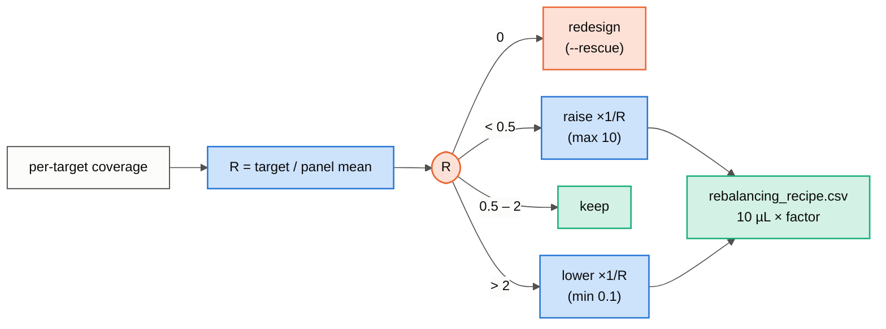

## Reproducibility

* **`conda-linux-64.lock`** pins 200 packages to exact builds (primer3-py 2.3.1, BLAST 2.17.0, bwa 0.7.19, samtools 1.25, cutadapt 5.2). `environment.yml` is the loose spec for other platforms.
* **Design manifest:** input hashes, every option, the seed, tool versions, git commit and a dirty-tree flag. **Analysis `_summary.json`:** the command, tool versions and input hashes.
* The same inputs and seed give identical output.
* **Honest gaps:** the lock file is Linux x86-64 only and there is no container. Version drift rarely matters but is not zero: primer3 2.3.1 and 2.4.0 differ on 3 of 1,300 ΔG values (up to 0.9 kcal/mol, enough to flip a pair near the −6 limit), though they designed identical primers.

## Verified

Real BLAST+, bwa, samtools and cutadapt. `bash scripts/check_all.sh` runs everything in about a minute (SARS-CoV-2 sparse and tiled designs, viewer, RNA junction check, a 50-gene E. coli design-simulate-analyse loop, the CLI on a fixture). CI runs lint and unit tests on every push; `real-tools.yml` runs the full check on demand.

| Test | Result |
|---|---|
| SARS-CoV-2 ORFs, sparse, wider primer limits | 10/10 designed, 1 pool |
| Whole-genome SARS-CoV-2 panels (figure above) | `--layout chain` 99.5% covered vs ARTIC 99.6%; tiled 60.0% (default limits) / 86.1% (wider limits) / 90.6% (+ `--num-candidates 100`). Scored by `research/benchmark_sars2/coverage_report.py`. A full chain run took about 5-6 minutes before the search budget was cut to 3,000 checks per segment (same result on cached candidates, not re-timed) |
| Do our metrics predict real ARTIC amplicon coverage? | No. Real coverage spans 44x-1522x; Spearman correlation with 12 metrics (Tm, GC, dimers, 3' stability, amplicon length and GC, ...) is \|rho\| <= 0.19, none significant at p < 0.05 (one dataset, one chemistry) |
| **Real reads:** public MiSeq ARTIC v3 run (98 amplicons, 27.7k pairs); `bash scripts/real_data_check.sh`, about 1 min, needs internet | 80% of pairs kept with `--either-orientation` (40% without: this library starts reads at either amplicon end), 99.96% mapped, mean 409×, fold-80 5.6; all 98 amplicons covered, lowest 44× |
| E. coli scale: 100 / 250 genes spread over the genome | 100/100 designed in 3 pools, 128 s; 250/250 in 4 pools [89, 83, 53, 25], no failures, about 11 min with 5 packing iterations |
| Human GRCh38 primary assembly, 100 random 400 bp regions (**not a panel**) | 79 designed in 3 pools, 18 min; the 21 failed regions are high-copy repeats (median about 26,000 genomic matches vs 1). The repeat screen alone took 6.4 min on this genome and caught 12 of the 21 |
| RNA junction example | junction-spanning pair: no genomic product; unconstrained pair: same-size genomic product |
| Analysis on an earlier 21-amplicon panel | 6 s; 6,299 of 6,300 pairs kept; identical to the previous Picard-based pipeline |
| Unit tests | 92 (90 plus two end-to-end tests that skip without bwa/samtools) |

## Limits and open items

* **No wet-lab validation.** The simulated-read results are uniform by construction. Real reads were run once, on a viral, single-sample public dataset not designed by this tool; the rebalancing recipe's effect is untested and no human amplicon reads have been run.
* **Dropout is not predictable from our metrics** (table above). The designs are checked for coverage and compatibility, not for yield.
* **Pool compatibility is the bottleneck** for tiled placement: tiles fail when every candidate dimerises with its pool. The dimer limits are absolute (self −9, heterodimer −8, 3′ end −6 kcal/mol, set for 19-21 nt primers) and are not scaled for the 20-30 nt primers AT-rich genomes need.
* Exact-hit BLAST screening only; near-matches are shown in the viewer but not enforced. Dimer screening uses the gene-specific sequence, not the tailed oligo. Strand specificity for RNA is decided at the RT step and cannot be verified from amplicon reads.
* Packing is a heuristic; the 1000 bp cross-product distance is a chosen default, not a validated one. The chain solver is a depth-first heuristic with a per-segment search budget.
* Targets must be chosen for specificity: random or repeat-derived regions are out of scope. The repeat screen is a conservative pre-filter, off by default for genomes over about 500 Mb.

## In-silico plexity study

How far does a tiled design go as plexity grows, and what does chemistry buy back? **935 overlapping E. coli tiles** (of 1,000; 65 had no specific primer pair) in two alternating pools, real primer3 and BLAST, 10 to 935 targets. Figures 1, 2 and 4 carry the findings; 3 and 5 are illustrative (model-based and E. coli-only). Code and details: [`research/plexity_study/`](research/plexity_study/README.md) (unmaintained).


| | 100-plex | 935-plex |
|---|---|---|
| Targets placeable under the plain dimer limit (first-fit / + repair) | 75% / 77% | 26% / 31% |
| Risky dimer pairs: plain / + hot-start / full ladder | 155 / 2 / 0 | 15,750 / 205 / 3 |
| Mean primer sequestered by dimers: plain / + hot-start / full ladder | 10.1% / 0.07% / 0.004% | 62% / 0.85% / 0.04% |
| Competitive off-target sites: plain / + hot-start / full ladder | 367 / 100 / 9 | 3,495 / 1,096 / 126 |

Brute-force screening alone places roughly 145 targets per pool under the plain limit; the levers that rescue it are commodity ones (hot-start polymerase, higher annealing temperature, lower primer concentration, rebalanced concentrations), though I cannot vouch for their IP status. **Read it as a model:**

1. The plain baseline holds 250 nM per primer at every plexity (0.23 mM total at 935-plex), a worst case; most commercial mixes are already hot-start.
2. Hot-start is modelled as dimers extending at 55 °C instead of 37 °C, the single assumption behind the biggest effect; real high-plex PCR still makes dimers with hot-start.
3. "Risky" means pair occupancy ≥ 0.42%, calibrated to the tool's own −6 kcal/mol limit, not to data; no sensitivity analysis has been run.
4. The uniformity model is uncalibrated; off-target covers a 4.6 Mb genome (a human-scale genome has ~1,000× more candidate sites).
5. Greedy selection plus one-swap repair is a pessimistic bound on what brute force can place.

## Repository

```
design.py                    design, packing, feedback, project file, manifest
core/                        biophysics.py (primer3, KAPA conditions) · chain.py (chain solver) · uniqueness.py (repeat screen)
analysis/                    analyze.py, metrics.py, balance.py, plot_uniformity.py, plot_coverage.py, simulator
scripts/                     design_viewer.py, check_all.sh, real_data_check.sh, make_ecoli_targets.py, ...
examples/sars2/              SARS-CoV-2 reference + ARTIC v3 scheme (the development genome)
design/targets/              sars2_* and ecoli_* target sets      common_refs/   E. coli K-12 genome + GFF (scale tests)
research/                    plexity_study/, benchmark_sars2/ (unmaintained, not linted or tested)
docs/                        README figures
test_design.py               unit tests               conda-linux-64.lock · environment.yml
```

Earlier iterations removed (recoverable from git history): the tail-only mode, Docker, Nextflow, GATK variant calling, Picard, FastQC, MultiQC, the hairpin clamp, the HTML dashboard, and the IGV figure scripts.
