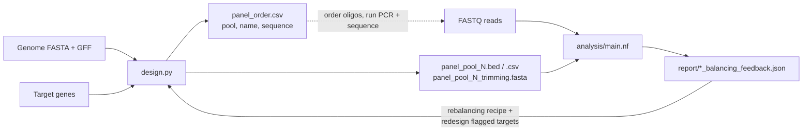
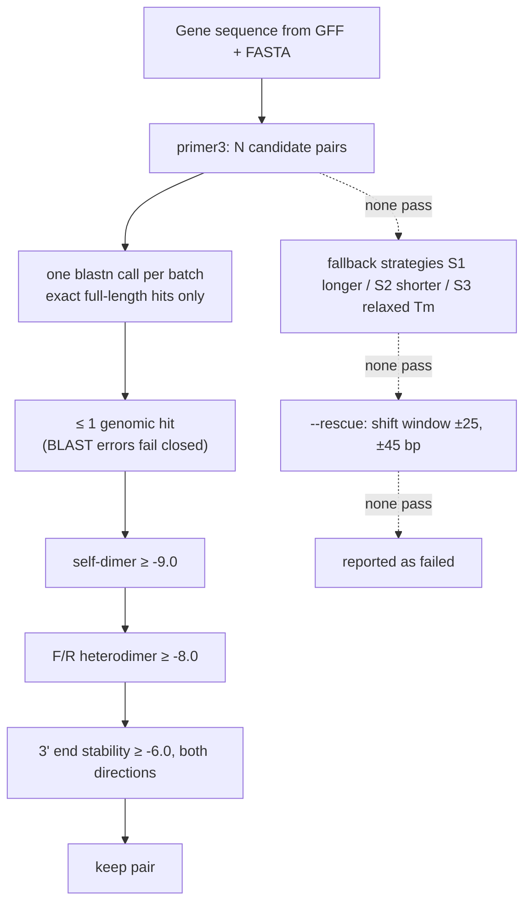
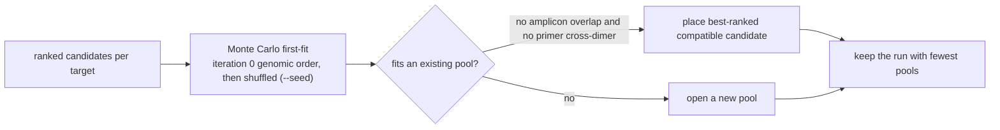
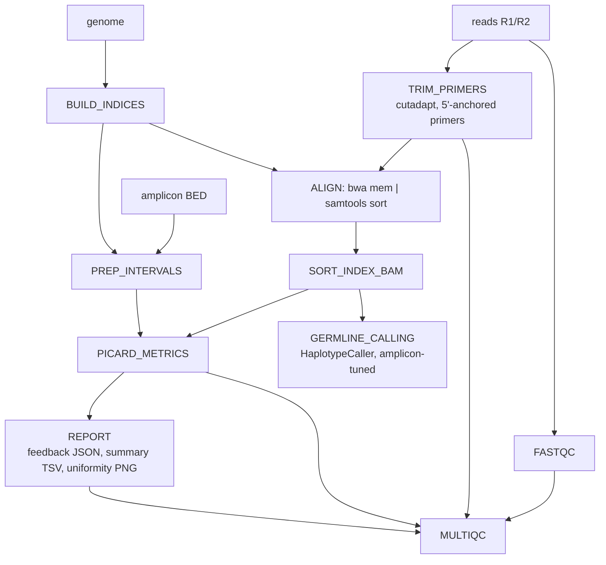
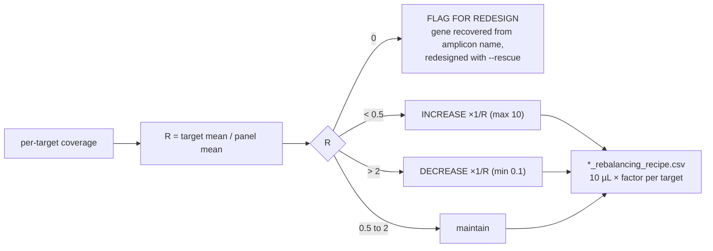
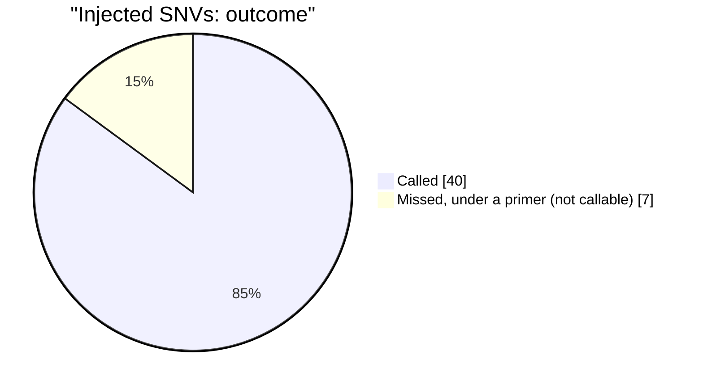
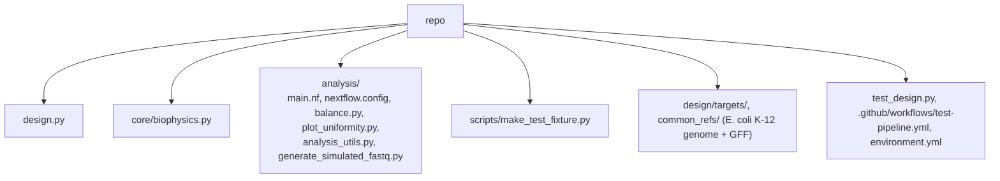

# 🧬 Multiplex Amplicon Toolkit

Three things, and only these:

1. **Design** multiplex PCR primer panels (primer3 + BLAST+ + dimer screening)
2. **Pack** the primers into the fewest compatible pools
3. **Analyse** amplicon sequencing (trim → align → coverage → variants) and feed coverage back into pool rebalancing

Primers are plain oligos: order them from IDT, Twist, GenScript or anyone else. No adapter tails, no custom chemistry.



---

## 1. Quick start

```bash
micromamba create -y -n amplicon_pipeline -f environment.yml && micromamba activate amplicon_pipeline

# design (21 housekeeping genes: ~40 s incl. building the BLAST db, 1 pool)
python design.py --target-file design/targets/housekeeping_genes.txt --output-prefix design/output/hk

# optional: simulate reads (also writes raw_data/HK.truth.tsv listing injected SNVs)
python analysis/generate_simulated_fastq.py --genome common_refs/ecoli_genome.fna \
    --bed design/output/hk_pool_1.bed --output-dir raw_data --sample-name HK --coverage 300 --seed 1

# analyse one pool
nextflow run analysis/main.nf --reads "raw_data/HK_R{1,2}.fastq.gz" \
    --bed design/output/hk_pool_1.bed --primers design/output/hk_pool_1_trimming.fasta --outdir results

# rebalance + redesign from coverage
python design.py --feedback results/report/HK_balancing_feedback.json --output-prefix design/output/hk_v2
```

Defaults: `--genome common_refs/ecoli_genome.fna`, `--gff common_refs/genomic.gff`, `--blast-db ncbi_data/ecoli_db` (built on first use).

---

## 2. Design (`design.py`)

### Per-target logic



| Setting | Value |
|---|---|
| Reaction conditions (applied to every primer3 call) | 2.5 mM Mg²⁺, 1.2 mM dNTP, 50 mM Na⁺, 50 nM DNA (KAPA HiFi) |
| Primer | 19–21 nt, Tm 59–61 °C (fallback 55–65), GC 40–60 % |
| Amplicon | 150–250 bp (fallback 100–350); must fit inside the gene |
| Dimer limits (kcal/mol) | self −9.0, heterodimer −8.0, 3′ end −6.0 (`--max-*-dg`) |

### Packing into pools



Overlapping amplicons (tiled designs) are never put in the same pool, so they cannot form mini-amplicons; sparse designs are packed purely on primer compatibility.

### Outputs (`--output-prefix`)

| File | Content |
|---|---|
| `<prefix>_order.csv` | `pool,name,sequence`: one row per oligo, ready to paste into a vendor order form |
| `<prefix>_pool_N.csv` | per-pair details: primers, Tm, amplicon coordinates, BLAST hit counts |
| `<prefix>_pool_N.bed` | amplicon intervals (names like `gene_amplicon_S0_3`) |
| `<prefix>_pool_N_trimming.fasta` | primers named `<gene>_F` / `<gene>_R` for read trimming |
| `<prefix>_failed_targets.txt` | targets that failed, or did not fit under `--force-single-pool` |

### Flags

| Flag | Default | Meaning |
|---|---|---|
| `--num-candidates` | 25 | pairs designed per target |
| `--monte-carlo-iters` / `--seed` | 20 / 0 | packing restarts / reproducibility |
| `--force-single-pool` | off | keep the largest compatible set; list the rest |
| `--force-sparse` | off | never allow overlapping amplicons in one pool |
| `--force-multiprime` | off | allow multi-copy primers (e.g. 16S) |
| `--rescue` | off | shift the window if no pair passes |
| `--add-hairpin-clamp` | off | experimental 5′ hairpin stem; see note below |

> **Hairpin clamp:** a 5′ extension intended to suppress primer dimers. It is untested here (no wet-lab or simulation evidence it helps) and unrelated to mini-amplicons, which only pool splitting prevents. Treat as experimental.

---

## 3. Analysis (`analysis/main.nf`)



**Trimming.** Reads begin at the primer, so each primer is matched anchored at the 5′ end; R1 is searched with forward primers and R2 with reverse primers. Reads that match no primer are discarded.

**Variant calling uses the sorted BAM, not a duplicate-marked one.** Amplicon reads share start positions, so >99 % of pairs look like duplicates and GATK's default filter would discard almost everything (mean depth 2 vs ~390× real).

**HaplotypeCaller is tuned for amplicon data** (`--hc_args`): k-mers 10/15/25 (clustered SNVs defeat the default 10/25) plus `--recover-all-dangling-branches --min-dangling-branch-length 1` (SNVs 1–2 bases from a read end have no flanking anchor).


| Output (`--outdir`) | Content |
|---|---|
| `trimmed_reads/` | trimmed FASTQ + cutadapt log |
| `bams/` | sorted, indexed BAM |
| `qc/picard/`, `qc/fastqc/` | Picard PCR/alignment/insert metrics, FastQC |
| `variants/germline/` | GVCF |
| `report/` | `*_balancing_feedback.json`, `*_target_summary.tsv`, `*_uniformity.png` |
| `multiqc/` | aggregated report |

---

## 4. Feedback loop



---

## 5. Ordering and running the primers

* Order `<prefix>_order.csv` oligos as standard primers (desalted is fine for PCR; plate format is convenient). Pool by the `pool` column.
* One pool = one PCR tube. Overlapping amplicons are already in different pools.
* If dimers or imbalance persist in the lab: lower per-primer concentration, use a hot-start polymerase, lengthen the annealing/extension step, then run the rebalancing loop above.

---

## 6. Verified results

Run with real BLAST+, BWA, Picard, GATK and Cutadapt from `environment.yml` (simulated reads, 300×).

| Test | Result |
|---|---|
| 21-gene panel | 1 pool, every primer has exactly 1 perfect genomic hit |
| Pipeline | 10 processes succeed in ~1.5 min; 6,299 / 6,300 pairs retained after trimming |
| Panel coverage | mean 397×, fold-80 1.33, 100 % of targets above 0.2× |
| Variants (47 injected SNVs) | 40 called, 0 false positives; all 7 misses lie under primers (trimmed by design), 0 in amplicon interiors |
| Unit tests | 25 passing; CI runs unit tests plus a real pipeline run on a small fixture |



**Limitations.** Variant calling is validated only on simulated reads (identical copies per amplicon, 0.1 % error). Genes shorter than the minimum amplicon cannot be designed. BLAST screening counts exact full-length hits only (3′-mismatch near-hits are not scored). Packing is randomised first-fit, not optimal. Primers are not checked for cross-products between non-overlapping amplicons in the same pool.

---

## 7. Repository



**Removed in this pruning** (all recoverable from git history): adapter tails and the tail-only mode, Docker, MarkDuplicates, bigWig tracks, Mutect2 / `--mode`, the HTML dashboard, the k-mer uniqueness and target-curation scripts, the simulator's thermal model, stale example panels, the duplicate uncleaned genome, and the pandas/deeptools dependencies.
