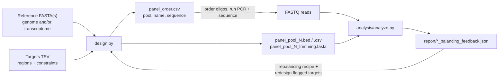
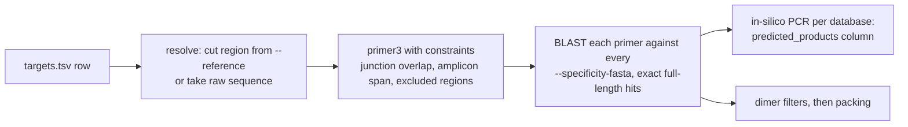
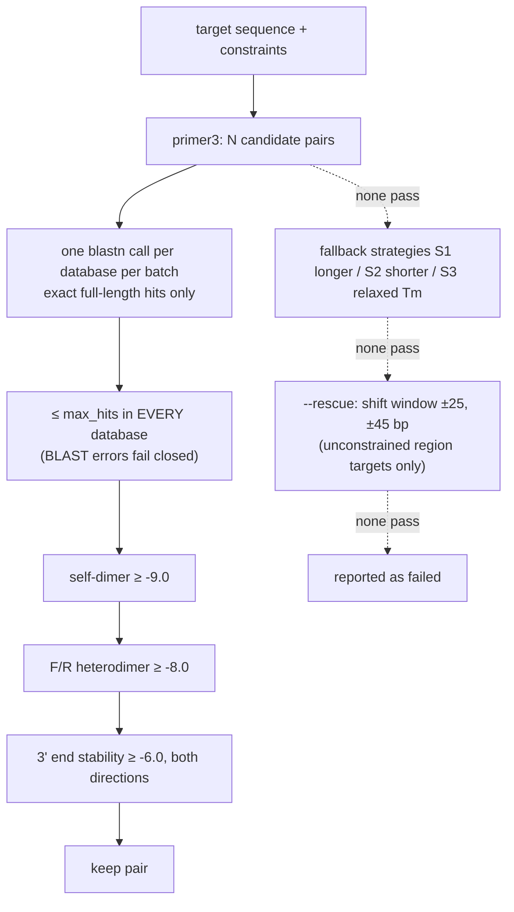
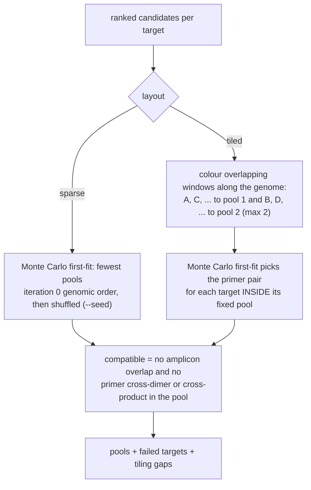
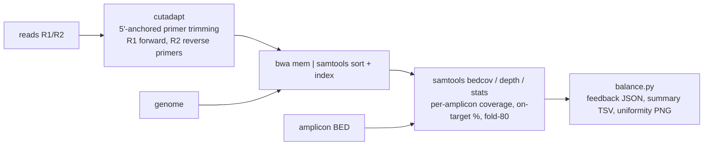
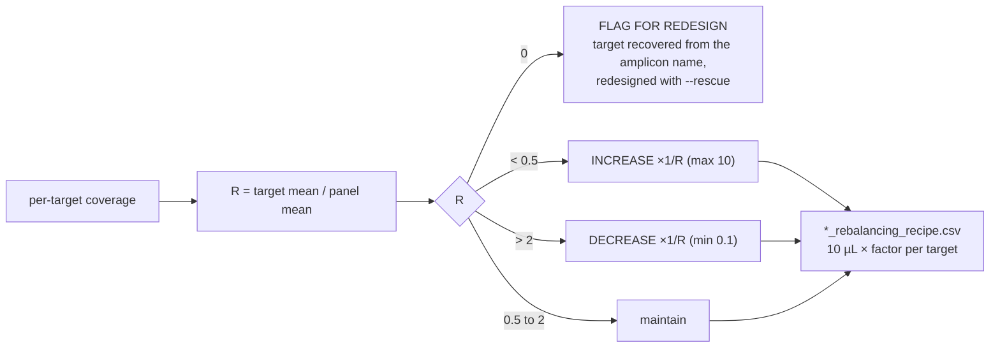
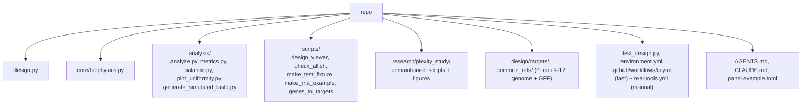

# 🧬 Multiplex Amplicon Toolkit

A platform for **custom-panel multiplex PCR**. You decide what to target (DNA regions, RNA/cDNA transcripts, anything with a sequence); the tool designs the primers, checks specificity, screens dimers and packs primers into pools. How well a target enriches is a function of how you specify it: for mRNA that means telling the tool where the splice junctions are.

Three things, and only these:

1. **Design** multiplex PCR primer panels (primer3 + BLAST+ + dimer screening)
2. **Pack** the primers into the fewest compatible pools
3. **Analyse** amplicon sequencing (trim → align → per-amplicon coverage) and feed coverage back into pool rebalancing

Primers are ordinary oligos from IDT, Twist, GenScript or anyone else, each carrying a truncated Illumina tail (P5 on the forward/sense primer, P7 on the reverse/antisense primer; configurable, or `--no-tails`). A later index PCR completes the adapters. No custom chemistry.



---

## 1. Quick start

```bash
micromamba create -y -n amplicon_pipeline -f environment.yml && micromamba activate amplicon_pipeline

# design: 21 E. coli housekeeping genes (whole-gene regions), 1 pool, ~10 s
python design.py --targets design/targets/housekeeping.tsv --output-prefix design/output/hk

# analyse sequencing of one pool
python analysis/analyze.py --reads "raw_data/HK_R{1,2}.fastq.gz" --genome common_refs/ecoli_genome.fna \
    --bed design/output/hk_pool_1.bed --primers design/output/hk_pool_1_trimming.fasta --outdir results

# rebalance + redesign flagged targets (needs the original targets table)
python design.py --feedback results/HK/HK_balancing_feedback.json --targets design/targets/housekeeping.tsv \
    --output-prefix design/output/hk_v2
```

Optional: simulate reads with `analysis/generate_simulated_fastq.py` (also writes `<sample>.truth.tsv` listing the injected SNVs). Gene names from a GFF can be turned into a targets table with `scripts/genes_to_targets.py`.

---

## 2. Project file and run manifest

Put the options in a TOML file instead of a long command line (`panel.example.toml` is annotated; paths are relative to the file, and any command-line option overrides it):

```bash
python design.py --project panel.example.toml
```

Every run writes `<prefix>_manifest.json`: inputs (path, size, sha256), all options, layout used, git commit and whether the tree was dirty, per-pool targets, failed targets, tiling gaps, output files and the suggested next command. It is the machine-readable summary an assistant should read first. `AGENTS.md` is the operating guide for AI assistants (workflow, guardrails, what not to claim).

---

## 3. Targets table

One TSV row per target. Only `name` is always required; give **either** a region (`reference` + `start` + `end`, 1-based inclusive, cut from `--reference`) **or** a raw `sequence`.

| Column | Meaning |
|---|---|
| `name` | unique target name |
| `reference`, `start`, `end` | region on a contig/transcript in `--reference` |
| `strand` | `+` (default) or `-`: the sense strand of the RNA/gene relative to the given sequence or region. Design is done on the sense strand (forward primer = sense), so for `-` targets the sequence is reverse-complemented and all positions below are mapped back. Reverse primer = antisense = the RT primer for stranded RNA |
| `sequence` | raw sequence instead of a region (`reference`/`start` then only set output coordinates) |
| `junctions` | comma-separated positions: **a primer must overlap each-or-one of these joins**. Give the 1-based position of the first base *after* the join (exon 2 starts at base 201 of the cDNA → `201`) |
| `span` | ranges the **amplicon must contain**, e.g. `140-160,300` |
| `avoid` | ranges **no primer may overlap**, e.g. `1-40` (SNPs, repeats, low complexity) |
| `amplicon_min`, `amplicon_max` | per-target size range (defaults `--amplicon-min/max`, 150–250) |
| `max_hits` | allowed exact hits per primer in each specificity database (default `--max-hits 1`; raise for isoforms or multi-copy genes) |

All positions in `junctions`/`span`/`avoid` are 1-based within the target sequence. Unsatisfiable constraints are reported per target, not silently ignored.



### DNA targets
Point `--reference` at the genome and list regions; the default specificity database is the reference itself. Use `avoid` to keep primers off known variants and `span` to force an amplicon to cover a site of interest.

### RNA targets
Design on the **transcript** and screen against **both transcriptome and genome**, so genomic-DNA amplification is visible:

```bash
python scripts/make_rna_example.py --outdir examples/rna_junction     # synthetic 3-exon gene
python design.py --targets examples/rna_junction/targets.tsv --reference examples/rna_junction/cdna.fa \
    --specificity-fasta examples/rna_junction/cdna.fa examples/rna_junction/genome.fa
```

| Target (same 650 nt transcript) | specificity hits (cDNA/genome) | `predicted_products` |
|---|---|---|
| `TX1_plain`, no constraint | F 1/1, R 1/1 | `cdna:TX1:91;genome:chrG:91`: **genomic DNA gives the same-size product** |
| `TX1_junction`, `junctions=201,401` | F **1/0**, R 1/1 | `cdna:TX1:88`: the junction-spanning primer cannot prime on genomic DNA |

For RNA also align to the transcript FASTA in the pipeline (`--genome cdna.fa`); RT and library chemistry are the wet-lab side.

---

## 4. Design (`design.py`)

### Per-target logic



| Setting | Value |
|---|---|
| Reaction conditions (applied to every primer3 call) | 2.5 mM Mg²⁺, 1.2 mM dNTP, 50 mM Na⁺, 50 nM DNA (KAPA HiFi) |
| Primer | 19–21 nt, Tm 59–61 °C (fallback 55–65), GC 40–60 % |
| Amplicon | 150–250 bp by default, per target via `amplicon_min/max` (fallbacks widen or narrow it); must fit inside the target |
| Dimer limits (kcal/mol) | self −9.0, heterodimer −8.0, 3′ end −6.0 (`--max-*-dg`) |

### Layouts and packing into pools

`--layout auto` (default) picks **tiled** if target windows or the chosen amplicons overlap, otherwise **sparse**.



| | sparse (interspersed) | tiled (tandem) |
|---|---|---|
| Pools | fewest that are compatible (1 whenever possible; `--max-pools N` caps it) | **at most 2**, alternating by position |
| Who decides the pool | the search | the genome order |
| What the search decides | pool and primer pair | primer pair only |
| Cross-target product block | facing primers closer than 1000 bp | closer than the max amplicon size (A and C share a pool about two amplicons apart) |
| Failure mode | targets left over under `--max-pools` | a target with no compatible pair in its pool, or a window overlapped by 2+ others |

**Tiling and blind spots.** Primers are trimmed before alignment, so two neighbouring amplicons that overlap by less than two primer lengths leave `40 − overlap` bp covered by no insert. Tiled designs report these in the log, `<prefix>_tiling_gaps.tsv` and the manifest. Make tile windows overlap generously (100 bp or more) and keep `amplicon_min` close to the window length; the tool does not yet optimise neighbour overlap itself.

### Outputs (`--output-prefix`)

| File | Content |
|---|---|
| `<prefix>_order.csv` | `pool,name,sequence,role`: one row per oligo (tails included), ready for a vendor order form; `role` marks the antisense primer as the RT primer for stranded RNA |
| `<prefix>_pool_N.csv` | per-pair details: primers, Tm, amplicon coordinates, hit counts per database, `predicted_products` (in-silico PCR from exact hits, ≤ `--max-product`) |
| `<prefix>_pool_N.bed` | amplicon intervals on the reference (names like `target_amplicon_S0_3`) |
| `<prefix>_pool_N_trimming.fasta` | gene-specific primers (no tails; reads start at the primer) named `<target>_F` / `<target>_R` |
| `<prefix>_failed_targets.txt` | targets that failed, or did not fit under `--force-single-pool` |

### Flags

| Flag | Default | Meaning |
|---|---|---|
| `--reference` | E. coli | FASTA(s) that region targets are cut from |
| `--specificity-fasta` | the reference | FASTA(s) to screen primers against (give transcriptome **and** genome for RNA) |
| `--max-hits` | 1 | allowed exact hits per primer per database |
| `--max-cross-product` | 1000 sparse / max amplicon tiled | primers of **different** targets that face each other closer than this (bp) cannot share a pool; 0 disables |
| `--fwd-tail` / `--rev-tail` / `--no-tails` | Illumina P5 / P7 20-mers | 5′ tails on the forward / reverse primer |
| `--num-candidates` | 25 | pairs designed per target |
| `--monte-carlo-iters` / `--seed` | 20 / 0 | packing restarts / reproducibility |
| `--layout` | auto | `auto`, `tiled` (max 2 pools by position) or `sparse` (fewest pools) |
| `--max-pools` | 0 | sparse only: keep at most N pools (0 = no limit); `--force-single-pool` = 1 |
| `--force-sparse` | off | never allow overlapping amplicons in one pool |
| `--force-multiprime` | off | allow multi-copy primers (e.g. 16S) |
| `--rescue` | off | shift the window of unconstrained region targets if no pair passes |


### Plexity limits: an in-silico study

How far does a tiled design go as plexity grows, and what does chemistry buy back? The study designs **935 overlapping E. coli tiles** (of 1,000; 65 had no specific primer pair for a 230-300 bp amplicon) in two alternating pools with real primer3 and BLAST, then measures dimer potential, capacity, off-target priming and (modelled) uniformity from 10 to 935 targets. **Everything here is in silico; nothing is wet-lab validated.**


Extendable-dimer pairs grow roughly as N² (155 at 100-plex, 15,750 at 935-plex). Screening holds the count at zero, but only by discarding targets:


| | 100-plex | 935-plex |
|---|---|---|
| Targets placeable under the plain dimer limit (first-fit / + repair) | 75% / 77% | 26% / 31% |
| Targets placeable under the hot-start, 60 °C, 50 nM limit | 100% | 99.9-100% |
| Risky dimer pairs: plain / + hot-start / full ladder | 155 / 2 / 0 | 15,750 / 205 / 3 |
| Mean primer 3′ end tied up in dimers: plain / + hot-start / full ladder | 10.1% / 0.07% / 0.004% | 62% / 0.85% / 0.04% |
| Competitive off-target sites: plain / + hot-start / full ladder | 367 / 100 / 9 | 3,495 / 1,096 / 126 |
| Amplicons ≥ 0.2× mean (model): plain / + hot-start / full ladder / + rebalanced | 68 / 100 / 92 / 100% | 8 / 99 / 91 / 100% |

The chemistry ladder adds one lever at a time (plain = no hot-start, 55 °C annealing, 250 nM per primer; then hot-start; 60 °C annealing; 50 nM primers; rebalanced primer concentrations). Hot-start does most of the work in the model:


Uniformity falls with dimers, and stringent annealing plus low concentration costs some of it back until each primer's concentration is rebalanced (what the coverage-feedback loop does empirically):


Competitive off-target sites (BLAST near-matches scored by primer-site duplex ΔG relative to the real target) fall about 3× with hot-start and 28× with the full ladder. Dimer screening does not select against off-target sites:


**What this means for design.**
* A brute-force search alone (no chemistry) places roughly 145 targets per pool under the plain limit. It stalls partly because tiled windows leave little primer choice (tile 11 had 10 distinct left and 3 distinct right primers sharing one motif, so one early pick blocked it). A joint search and more primer choice per tile would place more; more pools would too (about 7 for 1,000-plex by extrapolation, untested).
* The levers that rescue it are commodity ones: hot-start polymerase, higher annealing temperature, lower per-primer concentration, and concentration rebalancing. I cannot vouch for the IP status of any of them; proprietary named chemistries were deliberately left out.

**Do not over-read it.**
1. The *plain* baseline holds 250 nM per primer at every plexity (about 0.23 mM total at 935-plex), a worst case. Most commercial master mixes are already hot-start, so the realistic "no special primer chemistry" baseline is the hot-start step.
2. Hot-start is modelled as dimers extending at 55 °C instead of 37 °C. That single assumption drives the biggest effect, and real high-plex PCR still makes dimers with hot-start, so remaining risk is probably underestimated.
3. "Risky" means pair occupancy ≥ 0.42%, calibrated to the tool's own −6 kcal/mol at 37 °C. Dimer products amplify exponentially, so the true tolerance may be much stricter. No sensitivity analysis has been run; the scaling is probably robust, the absolute counts are not predictions.
4. The uniformity model is uncalibrated (efficiency from target occupancy and dimer sequestration, 30 cycles, no plateau); only relative comparisons mean anything.
5. Off-target covers E. coli only (4.6 Mb); a human-scale genome has roughly 1,000× more candidate sites. The selection is greedy (+ one-swap repair), a pessimistic bound on what brute force can place.

Reproduce (research code in [`research/plexity_study/`](research/plexity_study/README.md), not maintained or in CI; about 40 minutes on 4 cores; all numbers are in [`research/plexity_study/figures/plexity_study_table.csv`](research/plexity_study/figures/plexity_study_table.csv)):

```bash
python research/plexity_study/plexity_study.py candidates --workdir study --n-targets 1000
python research/plexity_study/plexity_study.py select --workdir study                 # greedy first-fit
python research/plexity_study/plexity_study.py select --workdir study --repair        # + one-swap repair
python research/plexity_study/plexity_study.py report --workdir study                 # dimers, uniformity
python research/plexity_study/plexity_study.py offtarget --workdir study
python research/plexity_study/plexity_plots.py --workdir study --outdir research/plexity_study/figures
```

---

## 5. Analysis (`analysis/analyze.py`)



```bash
python analysis/analyze.py --reads "raw_data/S_R{1,2}.fastq.gz" --genome ref.fa \
    --bed design/output/panel_pool_1.bed --primers design/output/panel_pool_1_trimming.fasta --outdir results
```

One run per pool (each has its own BED and primer FASTA). `{1,2}` marks the read number (a `*` before it matches several samples); a plain glob is treated as single-end. Only `cutadapt`, `bwa`, `samtools`, `numpy` and `matplotlib` are needed. A 21-amplicon, 6,300-pair panel takes about 6 seconds.

**Trimming.** Reads begin at the primer, so each primer is matched anchored at the 5′ end; R1 is searched with forward primers and R2 with reverse primers. Reads that match no primer are discarded, and if *none* match the run stops with an error (usually the wrong pool's primer FASTA).

**Metrics.** Per-amplicon mean coverage (`samtools bedcov`), per-base depth over the amplicons (`samtools depth`), and read/base counts (`samtools stats`) give mean target coverage, on-target base %, fold-80 (mean ÷ 20th percentile of target-base depth, reported as n/a when that percentile is 0, e.g. when short reads leave the trimmed primer sites uncovered) and % of amplicons above 0.2× the mean. On a 21-amplicon panel these reproduce the numbers the earlier Picard-based pipeline produced exactly (mean 397.407×, fold-80 1.329121, per-target means identical, same rebalancing actions).

**No variant calling.** Run any caller on `<sample>.sorted.bam`. Amplicon reads share start positions, so more than 99% of pairs look like duplicates: do not run duplicate-aware tools or filters on them.

| Output, in `<outdir>/<sample>/` | Content |
|---|---|
| `<sample>.sorted.bam` (+ `.bai`) | trimmed reads aligned to the reference |
| `<sample>.trimmed_R1/R2.fastq.gz`, `cutadapt.log` | trimmed reads and the trimming report |
| `target_coverage.tsv` | mean coverage per amplicon |
| `<sample>_balancing_feedback.json` | input to `design.py --feedback` |
| `<sample>_target_summary.tsv`, `<sample>_uniformity.png` | per-target recommendations; relative-coverage plot |
| `<sample>_summary.json` | trimming, mapping and panel metrics in one file |

---

## 6. Feedback loop



---

## 7. Ordering and running the primers

* Order `<prefix>_order.csv` oligos as standard primers (desalted is fine for PCR; plate format is convenient). Pool by the `pool` column.
* One pool = one PCR tube. Overlapping amplicons are already in different pools.
* If dimers or imbalance persist in the lab: lower per-primer concentration (more so as plexity grows), use a hot-start polymerase, raise or touch-down the annealing temperature, lengthen the extension step, then run the rebalancing loop above. The [in-silico study](#plexity-limits-an-in-silico-study) ranks these levers in a model (hot-start first); it is not a lab result.

---

## 8. Verified results

Run with real BLAST+, bwa, samtools and cutadapt from `environment.yml` (simulated reads, 300×).

| Test | Result |
|---|---|
| 21-gene panel | 1 pool, every primer has exactly 1 perfect genomic hit, no predicted off-target products |
| Synthetic spliced gene, real BLAST | junction-constrained target: no genomic product predicted; unconstrained: same-size genomic product flagged (table in section 3) |
| Analysis (21-gene panel, 6,300 simulated pairs) | ~6 s; 6,299 / 6,300 pairs retained, 100% mapped, mean 397×, fold-80 1.33, 100% of targets above 0.2×; **identical to the earlier Picard/Nextflow run** (per-target relative coverage within 2e-9, same rebalancing actions) |
| Tiled design, real BLAST (12 overlapping 300 bp windows) | **2 pools of 6, alternating (T01,T03,.. | T02,T04,..)**; all 12 placed, contiguous coverage, but 60 bp uncovered after primer trimming at three 20 bp overlaps (reported) |
| Plexity study (935 tiled tiles, real primer3 + BLAST) | dimer potential ~N²; plain-limit brute force places 31% of 935 targets (290) in 2 pools; hot-start/60 °C/50 nM places ~100%; see section 4 for the model and its caveats |
| Unit tests | 69 passing (68 + 1 skipped when bwa/samtools are absent); CI runs lint + unit tests only; `scripts/check_all.sh` runs everything with the real tools in ~20 s (after the one-off environment install) |

**Limitations.** Analysis is validated only on simulated reads (identical copies per amplicon, 0.1 % error). Targets shorter than the minimum amplicon cannot be designed (lower `amplicon_min` for them). BLAST screening counts exact full-length hits only (3′-mismatch near-hits are not scored). Packing is randomised first-fit, not optimal. Within a pool, products between different targets' primers are blocked below `--max-cross-product` (1000 bp sparse; the max amplicon size for tiled), a chosen default that is not validated.

---

## 9. Inspecting specificity

```bash
python scripts/design_viewer.py --prefix design/output/panel --reference common_refs/ecoli_genome.fna --outdir panel_view
```

Writes `specificity.html` (self-contained: genome overview, sortable target table, per-target locus view) plus IGV-loadable `amplicons.bed` (BED12, primers as blocks, coloured by pool), `mispriming_sites.bed`, `unintended_products.bed` and `session.xml` (IGV session; not tested in IGV desktop). It searches for **3′-anchored near-match priming sites** (default ≥ 16 aligned bp, ≤ 1 mismatch, exact last 4 bases) that exact-hit screening cannot see, and predicts products between any two facing sites in the same pool.

---

## 10. Repository



**Removed in this pruning** (all recoverable from git history): the tail-only mode and the second oligo format (tails themselves are back, see above), Docker, MarkDuplicates, bigWig tracks, Mutect2 / `--mode`, the HTML dashboard, **Nextflow, GATK variant calling, Picard, FastQC, MultiQC and the whole Java stack (replaced by `samtools` + Python, with Picard parity verified)**, the plexity-study scripts (moved to `research/`), the k-mer uniqueness and target-curation scripts, the simulator's thermal model, stale example panels, the duplicate uncleaned genome, and the pandas/deeptools dependencies.
