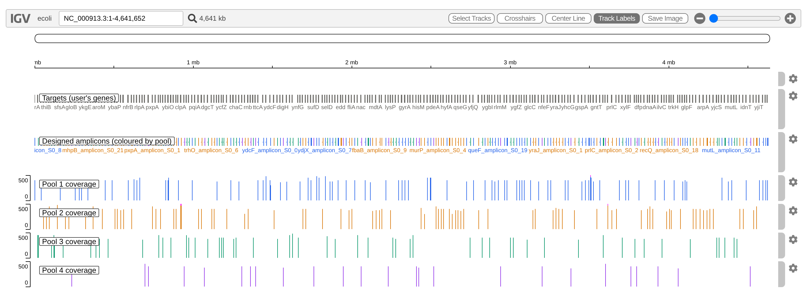
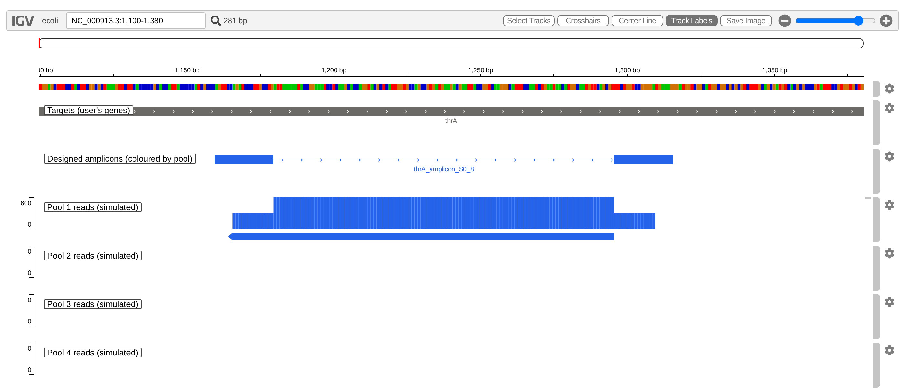
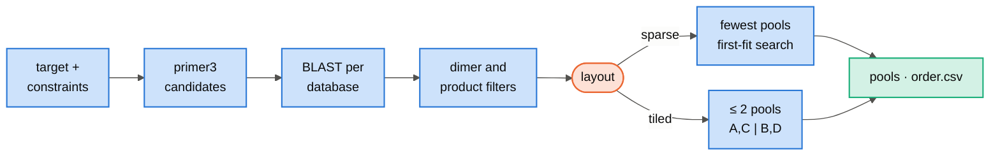
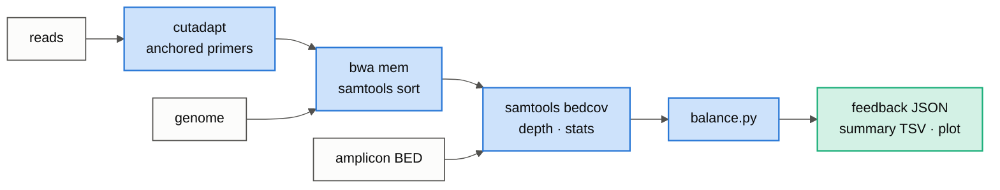
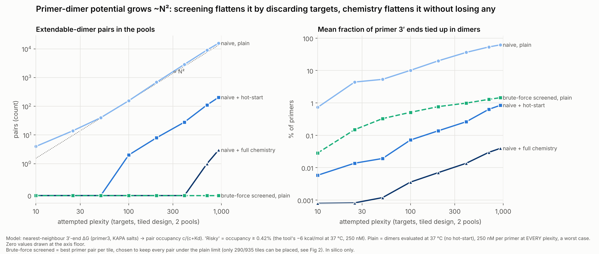
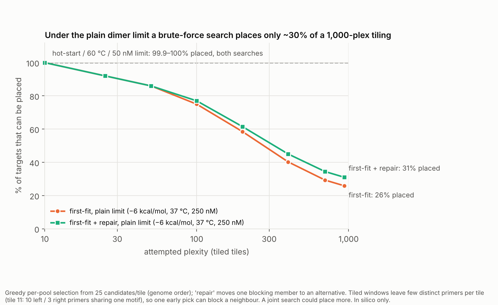
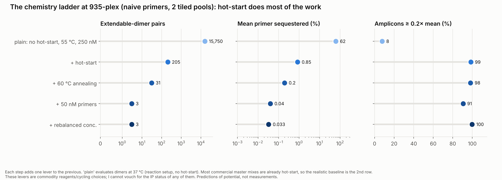
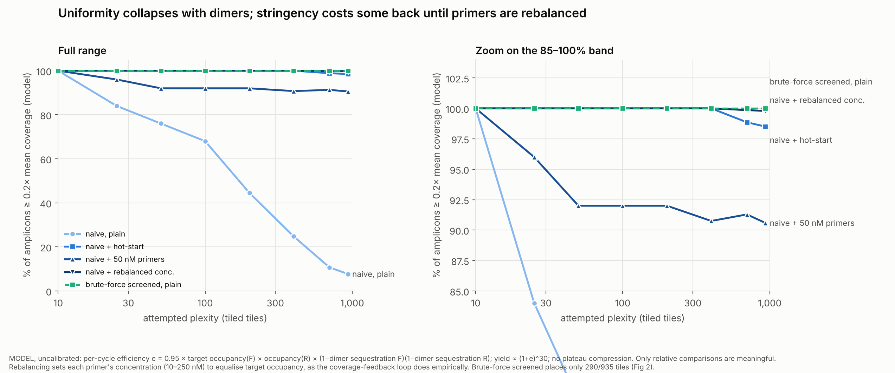
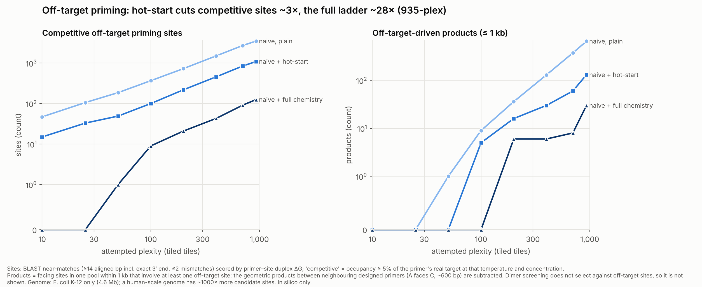

# Multiplex Amplicon Toolkit

[](https://github.com/AHumanBrain/my_amplicon_project/actions/workflows/ci.yml)

Custom-panel multiplex PCR for DNA or RNA targets. You decide what to target; the tool designs the primers, screens them, packs them into pools, and analyses the sequencing so coverage feeds back into pool rebalancing.

1. **Design** primers (primer3 + BLAST+ + dimer screening) for regions or sequences you specify
2. **Pack** them into the fewest compatible pools (at most two for tiled designs)
3. **Analyse** amplicon sequencing and turn per-amplicon coverage into a rebalancing recipe

Primers are ordinary oligos with truncated Illumina tails (P5 forward, P7 reverse), orderable from any vendor. No custom chemistry. Everything here is **in silico**: nothing is wet-lab validated.



```mermaid
%%{init: {"theme":"base","themeVariables":{"fontFamily":"Inter, system-ui, -apple-system, Segoe UI, sans-serif","fontSize":"15px","background":"#fcfcfb","primaryColor":"#cde2fb","primaryBorderColor":"#2a78d6","primaryTextColor":"#0b0b0b","secondaryColor":"#d3f1e5","tertiaryColor":"#fde1d6","lineColor":"#52514e","textColor":"#0b0b0b","clusterBkg":"#fcfcfb","clusterBorder":"#e4e3df","edgeLabelBackground":"#fcfcfb"},"flowchart":{"curve":"basis","nodeSpacing":30,"rankSpacing":42,"padding":12}}}%%
flowchart LR
    T["Targets TSV<br/>+ reference"]:::step --> D["design.py<br/>primers · pools"]:::step
    D --> O["order.csv<br/>pool BEDs<br/>manifest"]:::out
    O -. "order · PCR · sequence" .-> R["FASTQ"]:::plain
    R --> A["analyze.py<br/>trim · align · coverage"]:::step
    O --> A
    A --> F["report<br/>feedback JSON"]:::out
    F -- "rebalance · redesign" --> D
    classDef step fill:#cde2fb,stroke:#2a78d6,stroke-width:1.6px,color:#0b0b0b
    classDef out fill:#d3f1e5,stroke:#1baf7a,stroke-width:1.6px,color:#0b0b0b
    classDef warn fill:#fde1d6,stroke:#eb6834,stroke-width:1.6px,color:#0b0b0b
    classDef plain fill:#fcfcfb,stroke:#52514e,stroke-width:1.2px,color:#0b0b0b
```

*Blue: steps · green: files you get · orange: decisions and limits.*

## What a design looks like

A 250-gene design on the *E. coli* K-12 genome (`design/targets/ecoli_spread_250.tsv`), followed by in-silico multiplex PCR: one simulated tube per pool, reads trimmed and aligned by `analysis/analyze.py`, shown in IGV (igv.js).



Zoom to one target: the amplicon track shows the two primers as blocks; aligned reads start inside them (primers are trimmed) and only the pool that holds this amplicon has reads.



These reads are **simulated from the designed amplicons**, so 100% on-target and uniform coverage are true by construction. The figure shows that the design coordinates, pool assignment and analysis agree; it says nothing about real specificity or yield. The tool designs for the genes you choose; this panel is a demonstration, not a recommended panel. To rebuild the figures see `research/igv_showcase/` (unmaintained).

## Quick start

```bash
micromamba create -n amplicon_pipeline -f conda-linux-64.lock    # exact versions; or environment.yml
micromamba activate amplicon_pipeline

python design.py --project panel.example.toml                    # 21 E. coli genes, ~10 s -> 1 pool
python scripts/design_viewer.py --prefix design/output/housekeeping_demo \
    --reference common_refs/ecoli_genome.fna --outdir panel_view # open panel_view/specificity.html

# after sequencing one pool:
python analysis/analyze.py --reads "raw_data/S_R{1,2}.fastq.gz" --genome common_refs/ecoli_genome.fna \
    --bed design/output/housekeeping_demo_pool_1.bed \
    --primers design/output/housekeeping_demo_pool_1_trimming.fasta --outdir results
python design.py --project panel.example.toml --feedback results/S/S_balancing_feedback.json
```

A project file (`panel.example.toml`) holds the options; command-line flags override it. Every design run also writes `<prefix>_manifest.json`. `AGENTS.md` is the operating guide for AI assistants.

## Targets

One TSV row per target: either a region (`reference`, `start`, `end`, 1-based inclusive) or a raw `sequence`.

| Column | Meaning |
|---|---|
| `name` | unique target name |
| `strand` | `+` (default) or `-`: sense strand. Design runs on the sense strand; the antisense primer is the RT primer for stranded RNA |
| `junctions` | a primer must overlap one of these joins (position of the first base after the join) |
| `span` · `avoid` | the amplicon must contain a range · no primer may overlap a range |
| `amplicon_min/max` · `max_hits` | per-target size range · allowed exact hits per primer per database |

**RNA:** design on the transcript and screen against transcriptome *and* genome (`--specificity-fasta transcripts.fa genome.fa`). The report then shows genomic amplification: on a synthetic 3-exon gene, a junction-spanning primer pair has no genomic product, while the unconstrained pair predicts a same-size one (`python scripts/make_rna_example.py`).

Ready-made E. coli sets live in `design/targets/`: `housekeeping.tsv` (21 classic genes), `ecoli_spread_{50,100,250}.tsv` (genome-wide, evenly spaced) and `ecoli_tiled_{12,100}.tsv` (overlapping tiles). `scripts/make_ecoli_targets.py` regenerates them.

## Design



| | sparse (interspersed) | tiled (tandem) |
|---|---|---|
| Pools | fewest compatible (`--max-pools N` caps it) | **at most 2**, alternating by position |
| Cross-target product block | facing primers closer than 1000 bp | closer than the max amplicon size |
| Fails when | targets are left over under `--max-pools` | a target has no compatible pair in its pool |

`--layout auto` (default) picks tiled when target windows overlap. Tiled runs also report bases left uncovered after primer trimming (neighbours overlapping by less than two primer lengths): `<prefix>_tiling_gaps.tsv`.

**Thermodynamics:** KAPA HiFi conditions (2.5 mM Mg²⁺, 1.2 mM dNTP) on every primer3 call; primer 19-21 nt, Tm 59-61 °C; dimer limits self −9, heterodimer −8, 3′ end −6 kcal/mol (`--max-*-dg`).

**Outputs** (`--output-prefix`): `_order.csv` (pool, name, sequence, role), `_pool_N.csv` (per pair, with hit counts and `predicted_products`), `_pool_N.bed`, `_pool_N_trimming.fasta`, `_manifest.json`, and `_failed_targets.txt` when relevant.

**Key flags:** `--layout`, `--max-pools`, `--max-hits`, `--amplicon-min/max`, `--max-cross-product`, `--fwd-tail/--rev-tail/--no-tails`, `--seed` (same inputs + seed = identical output), `--rescue` (shift the window of unconstrained region targets).

**Inspect specificity:** `scripts/design_viewer.py` writes a self-contained `specificity.html` plus IGV-loadable BED tracks (untested in IGV desktop). It lists 3′-anchored near-match priming sites (≥ 16 aligned bp, ≤ 1 mismatch) that exact-hit screening cannot see.

## Analysis



`analysis/analyze.py` needs only `cutadapt`, `bwa`, `samtools`, `numpy` and `matplotlib`. One run per pool; `{1,2}` in `--reads` marks the read number. Reads begin at the primer, so primers are matched anchored at the 5′ end (R1 forward, R2 reverse, which is what the tailed P5/P7 primers give) and unmatched reads are discarded; if none match, the run stops with an error. If your library starts reads at either end of the amplicon (ligation or tagmentation preps), add `--either-orientation`; on the real ARTIC run below the default kept 40% of pairs and this flag 80%.

Metrics: mean target coverage, on-target base %, fold-80 (mean ÷ 20th percentile of target-base depth; n/a when that percentile is 0), and % of amplicons above 0.2× the mean. On a 21-amplicon panel these reproduce the earlier Picard-based pipeline exactly, in 6 seconds instead of 1½ minutes. Output per sample in `<outdir>/<sample>/`: sorted BAM, `target_coverage.tsv`, `<sample>_balancing_feedback.json`, `_target_summary.tsv`, `_uniformity.png`, `_summary.json` (metrics plus provenance).

There is no variant calling. Amplicon reads share start positions, so over 99% of pairs look like duplicates: do not run duplicate-aware tools or filters on the BAM.

## Feedback loop


## Reproducibility

* **`conda-linux-64.lock`** pins 200 packages to exact builds (primer3-py 2.3.1, BLAST 2.17.0, bwa 0.7.19, samtools 1.25, cutadapt 5.2). `environment.yml` is the loose spec for other platforms.
* **Design manifest:** input hashes, every option, the seed, tool versions, git commit and a dirty-tree flag. **Analysis `_summary.json`:** the command, tool versions and input hashes.
* The same inputs and seed give identical output (three real runs of a 92-target panel were byte-identical).
* **Honest gaps:** the lock file is Linux x86-64 only and there is no container. Version drift rarely matters but is not zero: primer3 2.3.1 and 2.4.0 differ on 3 of 1,300 ΔG values (up to 0.9 kcal/mol, enough to flip a pair near the −6 limit), though they designed identical primers. Real reads are not in the repository; simulated ones are reproducible from `--seed`.
* Workflow engines are not needed for this: the previous Nextflow pipeline pinned no tools either.

## Verified

Real BLAST+, bwa, samtools and cutadapt, simulated reads. Run everything with `bash scripts/check_all.sh` (about 2 minutes); CI runs lint and unit tests on every push, and `real-tools.yml` runs the full check on demand.

| Test | Result |
|---|---|
| Housekeeping panel (21 genes) | 1 pool; every primer has exactly one perfect genomic hit |
| 100 genes spread over the genome (`ecoli_spread_100`) | 100/100 designed, 3 pools [58, 37, 5], 128 s |
| 250 genes spread over the genome (`ecoli_spread_250`) | 250/250 designed, 4 pools [89, 83, 53, 25], no failures, no unintended predicted products; about 11 min with 5 packing iterations. Simulated reads: every pool mean about 380×, fold-80 1.26–1.29 (see IGV above) |
| Tiled design, 100 contiguous tiles (`ecoli_tiled_100`) | **Only 75/100 designed** (25 failed: no compatible pair in the tiled pool), 41 tiling gaps. A dense tiled panel is hard for this packer; read the failure list before ordering |
| Tiled design (12 overlapping tiles) | 2 pools of 6, alternating; reports 60 bp uncovered after primer trimming at three 20 bp overlaps |
| RNA junction example | junction-spanning pair: no genomic product; unconstrained pair: same-size genomic product |
| Analysis, 21-gene panel | 6 s; 6,299 of 6,300 pairs kept; mean 397×, fold-80 1.33; identical to the Picard run |
| **Real reads:** public MiSeq ARTIC v3 SARS-CoV-2 run (98 amplicons, 2 tiled pools, 27.7k pairs); `bash scripts/real_data_check.sh`, about 1 min, needs internet | 80% of pairs kept with `--either-orientation` (40% without), 99.96% mapped, mean 409×, **fold-80 5.6** (simulated: 1.3); all 98 amplicons covered, lowest 44× (amp98), with the known weak ARTIC v3 amplicons 64 and 70 among the lowest five; the recipe asks for 0.27× to 9× concentration changes |
| Unit tests | 73 (71 plus two end-to-end tests that skip without bwa/samtools) |

**Limits:** the simulated-read results are uniform by construction. The analysis has been run on one real public dataset, which is viral, single-sample and not designed by this tool, so the rebalancing recipe's effect is untested, and no human amplicon reads have been run (the hosts that hold them are unreachable from the dev sandbox); targets shorter than the minimum amplicon cannot be designed; BLAST screening counts exact hits (near-matches are informational); packing is a heuristic; the 1000 bp cross-product distance is a chosen default, not a validated one.

## In-silico plexity study

How far does a tiled design go as plexity grows, and what does chemistry buy back? **935 overlapping E. coli tiles** (of 1,000; 65 had no specific primer pair) in two alternating pools, real primer3 and BLAST, 10 to 935 targets. Figures 1, 2 and 4 carry the findings; 3 and 5 are illustrative (model-based and E. coli-only). Code and details: [`research/plexity_study/`](research/plexity_study/README.md) (unmaintained).











| | 100-plex | 935-plex |
|---|---|---|
| Targets placeable under the plain dimer limit (first-fit / + repair) | 75% / 77% | 26% / 31% |
| Risky dimer pairs: plain / + hot-start / full ladder | 155 / 2 / 0 | 15,750 / 205 / 3 |
| Mean primer sequestered by dimers: plain / + hot-start / full ladder | 10.1% / 0.07% / 0.004% | 62% / 0.85% / 0.04% |
| Competitive off-target sites: plain / + hot-start / full ladder | 367 / 100 / 9 | 3,495 / 1,096 / 126 |

Brute-force screening alone places roughly 145 targets per pool under the plain limit; the levers that rescue it are commodity ones (hot-start polymerase, higher annealing temperature, lower primer concentration, rebalanced concentrations), though I cannot vouch for their IP status. **Read it as a model:**

1. The plain baseline holds 250 nM per primer at every plexity (0.23 mM total at 935-plex), a worst case; most commercial mixes are already hot-start.
2. Hot-start is modelled as dimers extending at 55 °C instead of 37 °C, the single assumption behind the biggest effect; real high-plex PCR still makes dimers with hot-start.
3. "Risky" means pair occupancy ≥ 0.42%, calibrated to the tool's own −6 kcal/mol limit, not to data; no sensitivity analysis has been run.
4. The uniformity model is uncalibrated; off-target covers a 4.6 Mb genome (a human-scale genome has ~1,000× more candidate sites).
5. Greedy selection plus one-swap repair is a pessimistic bound on what brute force can place.

## Repository

```
design.py                    design, packing, feedback, project file, manifest
core/biophysics.py           primer3 thermodynamics (KAPA conditions)
analysis/                    analyze.py, metrics.py, balance.py, plot_uniformity.py, simulator
scripts/                     design_viewer.py, check_all.sh, make_ecoli_targets.py, make_rna_example.py, ...
design/targets/              E. coli target sets      common_refs/   E. coli K-12 genome + GFF
research/                    plexity_study/ and igv_showcase/ (unmaintained)
docs/igv/                    IGV figures
test_design.py               unit tests               conda-linux-64.lock · environment.yml
```

Earlier iterations removed (recoverable from git history): the tail-only mode, Docker, Nextflow, GATK variant calling, Picard, FastQC, MultiQC, the hairpin clamp, and the HTML dashboard.
