# 🧬 Multiplex Amplicon Toolkit

Design multiplex PCR primer panels, simulate reads, analyse sequencing data with Nextflow, and feed coverage back into pool rebalancing.

| | |
|---|---|
| **Design** | `design.py` → primer3 + BLAST+ + dimer screening + pool packing |
| **Analyse** | `analysis/main.nf` → Cutadapt, BWA, Picard, GATK, deepTools, MultiQC |
| **Close the loop** | coverage JSON → pipetting recipe + redesign of failed targets |
| **Stack** | conda env (`environment.yml`) or Docker (`Dockerfile`); Python 3.11, Nextflow ≥ 25.04 |

---

## 1. Big picture

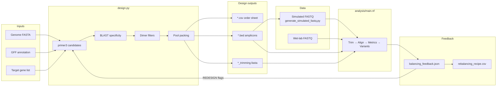

---

## 2. Quick start

```bash
# environment (conda/micromamba) – or: docker build -t amplicon-project .
micromamba create -y -n amplicon_pipeline -f environment.yml
micromamba activate amplicon_pipeline

# 1. design a panel (21 housekeeping genes ≈ 7 s)
python design.py --genome common_refs/ecoli_genome.cleaned.fna \
    --gff common_refs/genomic.gff \
    --target-file design/targets/housekeeping_genes.txt \
    --blast-db ncbi_data/ecoli_db --output-prefix design/output/hk

# 2. simulate reads (also writes raw_data/HK.truth.tsv, the injected SNVs)
python analysis/generate_simulated_fastq.py --genome common_refs/ecoli_genome.cleaned.fna \
    --bed design/output/hk_pool_1.bed --output-dir raw_data --sample-name HK --coverage 300 --seed 1

# 3. analyse
nextflow run analysis/main.nf --genome common_refs/ecoli_genome.cleaned.fna \
    --reads "raw_data/HK_R{1,2}.fastq.gz" --bed design/output/hk_pool_1.bed \
    --primers design/output/hk_pool_1_trimming.fasta --outdir results

# 4. rebalance / redesign from coverage
python design.py --feedback results/coverage/HK_balancing_feedback.json --rescue \
    --output-prefix design/output/hk_v2
```

---

## 3. Module 1 – Primer design (`design.py`)

### 3.1 Per-target logic

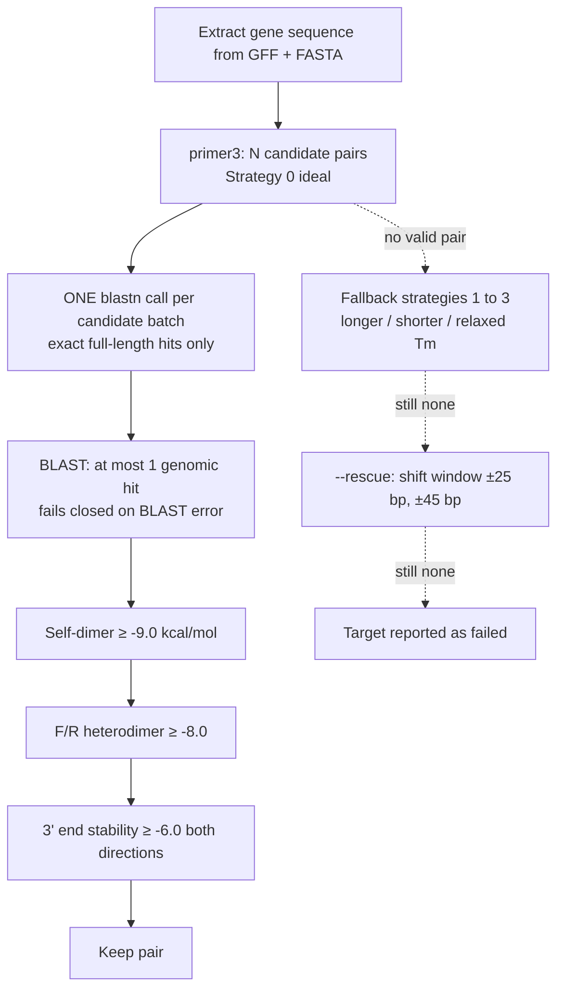

### 3.2 Packing candidates into pools

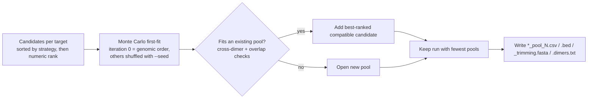

### 3.3 Thermodynamic model

| Setting | Value | Note |
|---|---|---|
| Mg²⁺ / dNTP / Na⁺ / DNA | 2.5 mM / 1.2 mM / 50 mM / 50 nM | KAPA HiFi; **now applied to every primer3 call** |
| Tm window | 59–61 °C (fallback 55–65) | GC 40–60 %, 19–21 nt |
| Amplicon | 150–250 bp (fallback 100–350) | must fit inside the gene |
| Self-dimer / heterodimer / 3′ end | −9.0 / −8.0 / −6.0 kcal/mol | override with `--max-*-dg` |

### 3.4 Modes and key flags

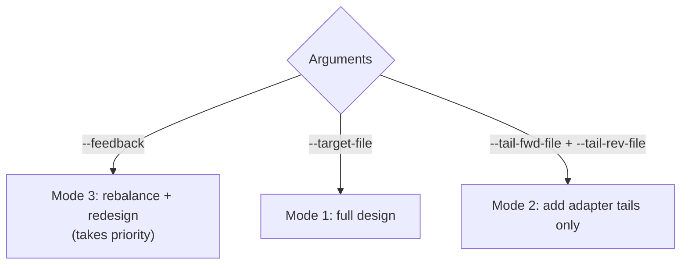

| Flag | Default | Purpose |
|---|---|---|
| `--num-candidates` | 25 | pairs designed per target |
| `--monte-carlo-iters` | 20 | packing restarts |
| `--seed` | 0 | reproducible packing |
| `--force-single-pool` | off | one tube; targets that don't fit are **listed in the log**, not silently dropped |
| `--force-sparse` | off | enforce zero amplicon overlap |
| `--force-multiprime` | off | allow multi-copy loci (e.g. 16S) |
| `--oligo-format` | `rc_tailed` | or `fwd_tailed` (+ `--add-hairpin-clamp`) |
| `--output-prefix` | `design/output/final_primers` | |
| `--log-file` | none | optional log file |

---

## 4. Module 2 – Nextflow pipeline (`analysis/main.nf`)

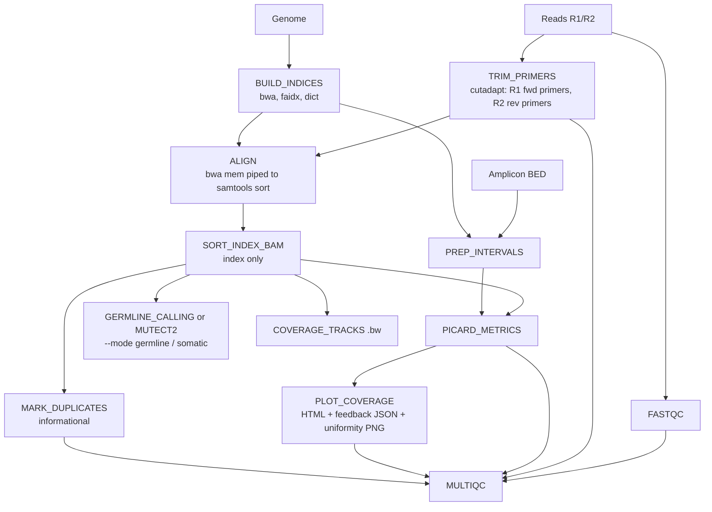

### Primer trimming

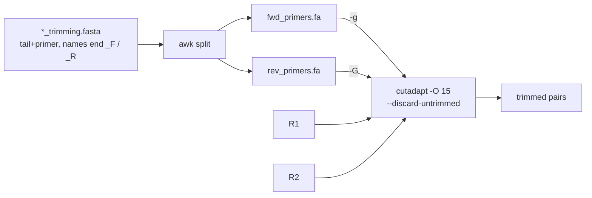

Reads start inside tail+primer, so partial 5′ matches are expected; `--min_primer_overlap` (default 15) prevents spurious short hits.

### Why variants are called on the *non*-duplicate-marked BAM

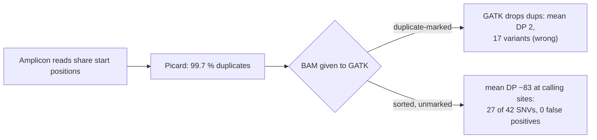

### Outputs (`--outdir`)

| Path | Content |
|---|---|
| `trimmed_reads/` | trimmed FASTQ + cutadapt log |
| `bams/` | sorted + indexed BAM, marked BAM, dup metrics |
| `qc/picard/`, `qc/fastqc/` | Picard PCR/alignment/insert metrics, FastQC |
| `variants/germline` or `somatic/` | GVCF / Mutect2 VCF |
| `coverage/` | bigWig, `*_coverage_report.html`, `*_uniformity.png`, `*_balancing_feedback.json` |
| `multiqc/` | aggregated report |

---

## 5. Module 3 – Feedback loop

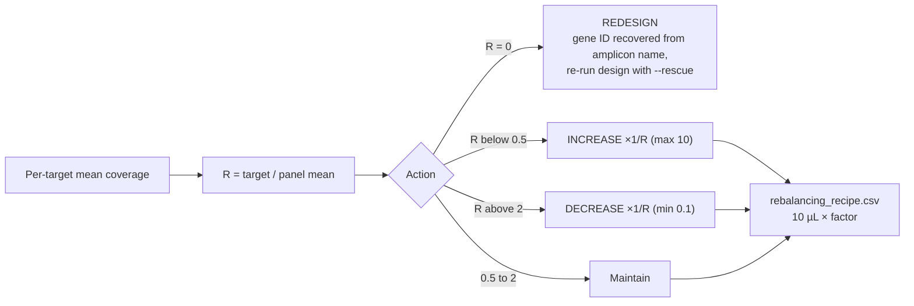

---

## 6. Simulator (`analysis/generate_simulated_fastq.py`)

Deterministic for a given `--seed`; streams to gzip. Options: `--coverage`, `--non-uniform` (10–200 % per amplicon), `--thermal-bias` (coverage falls 20 %/°C from a per-target optimum near 62 °C, stable via CRC32), `--mutation-rate` (default 1 %), `--error-rate` (0.1 %). Writes `<sample>.truth.tsv` listing every injected SNV.

---

## 7. What changed (this revision)

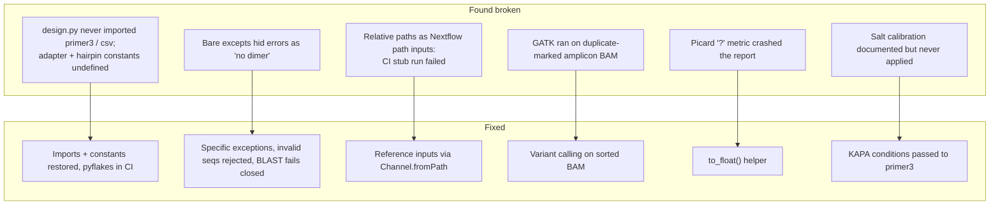

**Also improved:** BLAST batched (1 call per batch instead of 2 per pair); numeric candidate ranking (was a string sort); Picard-safe BED names; thresholds propagated to worker processes; `--seed`; single-pool no longer drops targets silently; `bwa | samtools sort` with `task.cpus`; correct R1/R2 primer trimming; no `errorStrategy 'ignore'`; seeded simulator with truth file; numpy k-mer script (verified against brute force; 4.6 Mbp, k=12–16 in ~7 s); HTML-escaped reports; `.gitignore` no longer contradicts tracked files (example panels in `design/examples/`).

---

## 8. Verified results

Run with real BLAST+, BWA, Picard, GATK and Cutadapt from `environment.yml`.

| Test | Result |
|---|---|
| 21-gene panel | designed in ~7 s → **1 pool**; all 42 primers have exactly 1 perfect genomic hit |
| 100-gene stress list | 92 designed in **3 pools (62 / 27 / 3)**; 8 failed (e.g. `thrL`, `sokC` are shorter than the minimum amplicon) |
| Primer trimming | 6,289 / 6,300 pairs retained (99.8 %) |
| Pipeline | all 12 processes succeed on panel reads and on the CI fixture |
| Panel coverage | mean 390×, fold-80 1.32, 100 % of targets above 0.2× |
| Unit tests | 27 passing |

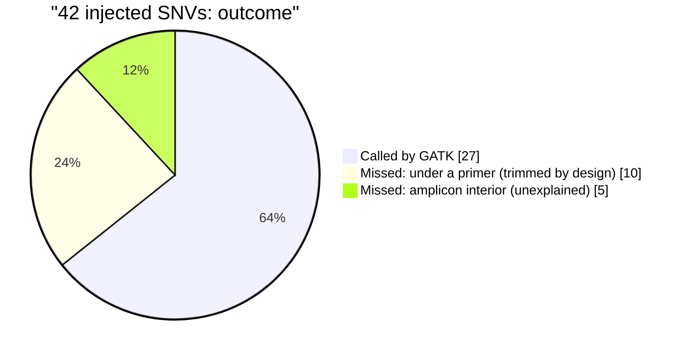

---

## 9. Known limitations / open items

* **5 interior SNVs are not called** although the BAM pileup shows them at 100 % allele fraction and 300×; under investigation.
* **Short genes** (below ~100 bp) cannot fit an amplicon; designing on gene ± flank would fix this.
* **Specificity** counts only exact full-length matches; 3′-mismatch near-hits are not scored.
* **Packing** is randomised first-fit; graph colouring or ILP might beat 3 pools on the 100-gene list.
* **Assumption:** reads begin at the primer (adapter tail not sequenced). Revisit `--min_primer_overlap` if your library prep differs.

---

## 10. Repository layout and CI

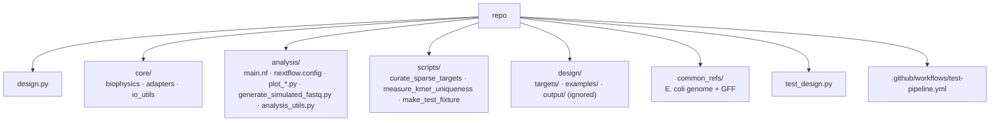


---

## 11. FAQ

**Why several pool files?** Overlapping amplicons or mutually dimerising primers can't share a tube; the packer splits them (`_pool_1`, `_pool_2`, …).
**Fold-80 penalty?** Extra sequencing needed to bring 80 % of targets to the mean; lower is more uniform.
**Single-end data?** Detected automatically; Cutadapt/BWA adapt, insert-size metrics are skipped gracefully.
**`--rescue`?** Shifts the extraction window (±25 bp, ±45 bp) when no pair passes at the default position.
