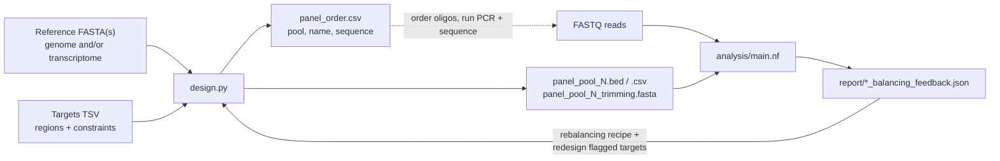
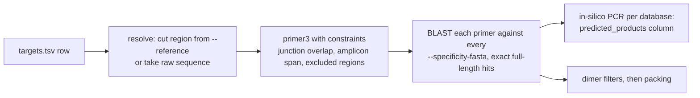
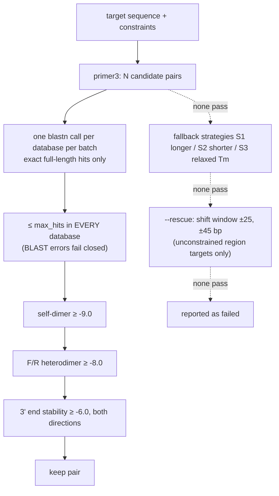
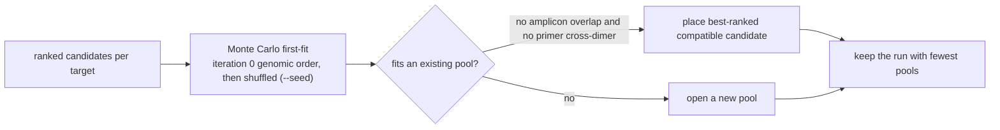
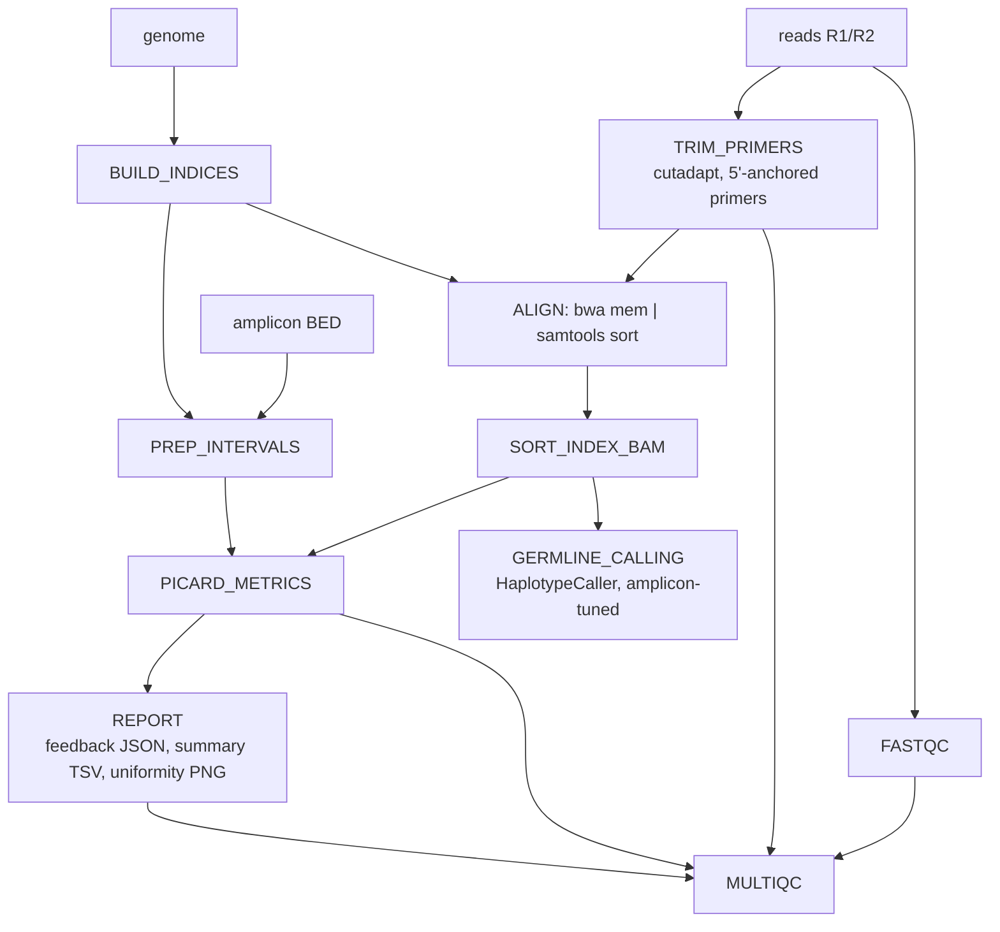
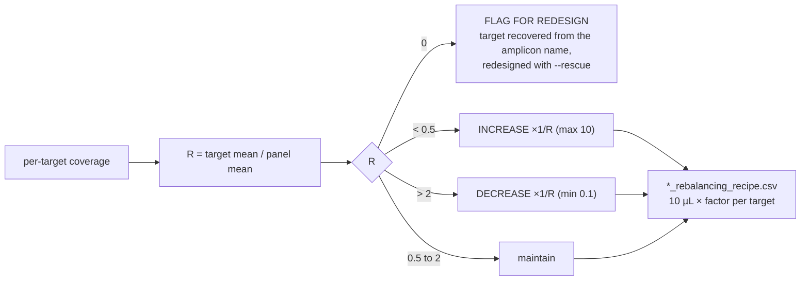
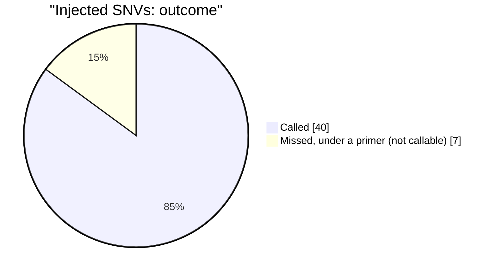
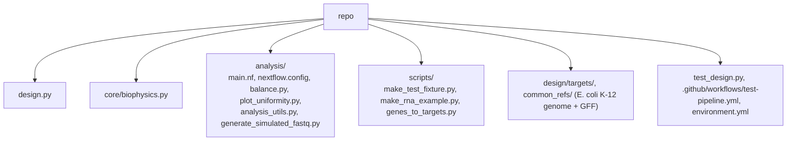

# 🧬 Multiplex Amplicon Toolkit

A platform for **custom-panel multiplex PCR**. You decide what to target (DNA regions, RNA/cDNA transcripts, anything with a sequence); the tool designs the primers, checks specificity, screens dimers and packs primers into pools. How well a target enriches is a function of how you specify it: for mRNA that means telling the tool where the splice junctions are.

Three things, and only these:

1. **Design** multiplex PCR primer panels (primer3 + BLAST+ + dimer screening)
2. **Pack** the primers into the fewest compatible pools
3. **Analyse** amplicon sequencing (trim → align → coverage → variants) and feed coverage back into pool rebalancing

Primers are ordinary oligos from IDT, Twist, GenScript or anyone else, each carrying a truncated Illumina tail (P5 on the forward/sense primer, P7 on the reverse/antisense primer; configurable, or `--no-tails`). A later index PCR completes the adapters. No custom chemistry.



---

## 1. Quick start

```bash
micromamba create -y -n amplicon_pipeline -f environment.yml && micromamba activate amplicon_pipeline

# design: 21 E. coli housekeeping genes (whole-gene regions), 1 pool, ~10 s
python design.py --targets design/targets/housekeeping.tsv --output-prefix design/output/hk

# analyse sequencing of one pool
nextflow run analysis/main.nf --reads "raw_data/HK_R{1,2}.fastq.gz" --genome common_refs/ecoli_genome.fna \
    --bed design/output/hk_pool_1.bed --primers design/output/hk_pool_1_trimming.fasta --outdir results

# rebalance + redesign flagged targets (needs the original targets table)
python design.py --feedback results/report/HK_balancing_feedback.json --targets design/targets/housekeeping.tsv \
    --output-prefix design/output/hk_v2
```

Optional: simulate reads with `analysis/generate_simulated_fastq.py` (also writes `<sample>.truth.tsv` listing the injected SNVs). Gene names from a GFF can be turned into a targets table with `scripts/genes_to_targets.py`.

---

## 2. Targets table

One TSV row per target. Only `name` is always required; give **either** a region (`reference` + `start` + `end`, 1-based inclusive, cut from `--reference`) **or** a raw `sequence`.

| Column | Meaning |
|---|---|
| `name` | unique target name |
| `reference`, `start`, `end` | region on a contig/transcript in `--reference` |
| `strand` | `+` (default) or `-`: the sense strand of the RNA/gene relative to the given sequence or region. Design is done on the sense strand (forward primer = sense), so for `-` targets the sequence is reverse-complemented and all positions below are mapped back. Reverse primer = antisense = the RT primer for stranded RNA |
| `sequence` | raw sequence instead of a region (`reference`/`start` then only set output coordinates) |
| `junctions` | comma-separated positions: **a primer must overlap each-or-one of these joins**. Give the 1-based position of the first base *after* the join (exon 2 starts at base 201 of the cDNA → `201`) |
| `span` | ranges the **amplicon must contain**, e.g. `140-160,300` |
| `avoid` | ranges **no primer may overlap**, e.g. `1-40` (SNPs, repeats, low complexity) |
| `amplicon_min`, `amplicon_max` | per-target size range (defaults `--amplicon-min/max`, 150–250) |
| `max_hits` | allowed exact hits per primer in each specificity database (default `--max-hits 1`; raise for isoforms or multi-copy genes) |

All positions in `junctions`/`span`/`avoid` are 1-based within the target sequence. Unsatisfiable constraints are reported per target, not silently ignored.



### DNA targets
Point `--reference` at the genome and list regions; the default specificity database is the reference itself. Use `avoid` to keep primers off known variants and `span` to force an amplicon to cover a site of interest.

### RNA targets
Design on the **transcript** and screen against **both transcriptome and genome**, so genomic-DNA amplification is visible:

```bash
python scripts/make_rna_example.py --outdir examples/rna_junction     # synthetic 3-exon gene
python design.py --targets examples/rna_junction/targets.tsv --reference examples/rna_junction/cdna.fa \
    --specificity-fasta examples/rna_junction/cdna.fa examples/rna_junction/genome.fa
```

| Target (same 650 nt transcript) | specificity hits (cDNA/genome) | `predicted_products` |
|---|---|---|
| `TX1_plain`, no constraint | F 1/1, R 1/1 | `cdna:TX1:91;genome:chrG:91`: **genomic DNA gives the same-size product** |
| `TX1_junction`, `junctions=201,401` | F **1/0**, R 1/1 | `cdna:TX1:88`: the junction-spanning primer cannot prime on genomic DNA |

For RNA also align to the transcript FASTA in the pipeline (`--genome cdna.fa`); RT and library chemistry are the wet-lab side.

---

## 3. Design (`design.py`)

### Per-target logic



| Setting | Value |
|---|---|
| Reaction conditions (applied to every primer3 call) | 2.5 mM Mg²⁺, 1.2 mM dNTP, 50 mM Na⁺, 50 nM DNA (KAPA HiFi) |
| Primer | 19–21 nt, Tm 59–61 °C (fallback 55–65), GC 40–60 % |
| Amplicon | 150–250 bp by default, per target via `amplicon_min/max` (fallbacks widen or narrow it); must fit inside the target |
| Dimer limits (kcal/mol) | self −9.0, heterodimer −8.0, 3′ end −6.0 (`--max-*-dg`) |

### Packing into pools



Overlapping amplicons (tiled designs) are never put in the same pool. Facing primers from different targets are also kept apart (`--max-cross-product`): on a dense 52-target test the old overlap-only check left 36 such designed-primer products between 257 bp and 2 kb in the same pool. Everything else is packed on primer-dimer compatibility.

### Outputs (`--output-prefix`)

| File | Content |
|---|---|
| `<prefix>_order.csv` | `pool,name,sequence,role`: one row per oligo (tails included), ready for a vendor order form; `role` marks the antisense primer as the RT primer for stranded RNA |
| `<prefix>_pool_N.csv` | per-pair details: primers, Tm, amplicon coordinates, hit counts per database, `predicted_products` (in-silico PCR from exact hits, ≤ `--max-product`) |
| `<prefix>_pool_N.bed` | amplicon intervals on the reference (names like `target_amplicon_S0_3`) |
| `<prefix>_pool_N_trimming.fasta` | gene-specific primers (no tails; reads start at the primer) named `<target>_F` / `<target>_R` |
| `<prefix>_failed_targets.txt` | targets that failed, or did not fit under `--force-single-pool` |

### Flags

| Flag | Default | Meaning |
|---|---|---|
| `--reference` | E. coli | FASTA(s) that region targets are cut from |
| `--specificity-fasta` | the reference | FASTA(s) to screen primers against (give transcriptome **and** genome for RNA) |
| `--max-hits` | 1 | allowed exact hits per primer per database |
| `--max-cross-product` | 1000 | primers of **different** targets that face each other closer than this (bp) cannot share a pool; 0 disables |
| `--fwd-tail` / `--rev-tail` / `--no-tails` | Illumina P5 / P7 20-mers | 5′ tails on the forward / reverse primer |
| `--num-candidates` | 25 | pairs designed per target |
| `--monte-carlo-iters` / `--seed` | 20 / 0 | packing restarts / reproducibility |
| `--force-single-pool` | off | keep the largest compatible set; list the rest |
| `--force-sparse` | off | never allow overlapping amplicons in one pool |
| `--force-multiprime` | off | allow multi-copy primers (e.g. 16S) |
| `--rescue` | off | shift the window of unconstrained region targets if no pair passes |
| `--add-hairpin-clamp` | off | experimental 5′ hairpin stem; see note below |

> **Hairpin clamp:** a 5′ extension intended to suppress primer dimers. It is untested here (no wet-lab or simulation evidence it helps) and unrelated to mini-amplicons, which only pool splitting prevents. Treat as experimental.

---

## 4. Analysis (`analysis/main.nf`)



**Trimming.** Reads begin at the primer, so each primer is matched anchored at the 5′ end; R1 is searched with forward primers and R2 with reverse primers. Reads that match no primer are discarded.

**Variant calling uses the sorted BAM, not a duplicate-marked one.** Amplicon reads share start positions, so >99 % of pairs look like duplicates and GATK's default filter would discard almost everything (mean depth 2 vs ~390× real).

**HaplotypeCaller is tuned for amplicon data** (`--hc_args`): k-mers 10/15/25 (clustered SNVs defeat the default 10/25) plus `--recover-all-dangling-branches --min-dangling-branch-length 1` (SNVs 1–2 bases from a read end have no flanking anchor).


| Output (`--outdir`) | Content |
|---|---|
| `trimmed_reads/` | trimmed FASTQ + cutadapt log |
| `bams/` | sorted, indexed BAM |
| `qc/picard/`, `qc/fastqc/` | Picard PCR/alignment/insert metrics, FastQC |
| `variants/germline/` | GVCF |
| `report/` | `*_balancing_feedback.json`, `*_target_summary.tsv`, `*_uniformity.png` |
| `multiqc/` | aggregated report |

---

## 5. Feedback loop



---

## 6. Ordering and running the primers

* Order `<prefix>_order.csv` oligos as standard primers (desalted is fine for PCR; plate format is convenient). Pool by the `pool` column.
* One pool = one PCR tube. Overlapping amplicons are already in different pools.
* If dimers or imbalance persist in the lab: lower per-primer concentration, use a hot-start polymerase, lengthen the annealing/extension step, then run the rebalancing loop above.

---

## 7. Verified results

Run with real BLAST+, BWA, Picard, GATK and Cutadapt from `environment.yml` (simulated reads, 300×).

| Test | Result |
|---|---|
| 21-gene panel | 1 pool, every primer has exactly 1 perfect genomic hit, no predicted off-target products |
| Synthetic spliced gene, real BLAST | junction-constrained target: no genomic product predicted; unconstrained: same-size genomic product flagged (table in section 2) |
| Pipeline | 10 processes succeed in ~1.5 min; 6,299 / 6,300 pairs retained after trimming |
| Panel coverage | mean 397×, fold-80 1.33, 100 % of targets above 0.2× |
| Variants (47 injected SNVs) | 40 called, 0 false positives; all 7 misses lie under primers (trimmed by design), 0 in amplicon interiors |
| Unit tests | 36 passing; CI runs them plus a real-BLAST design smoke test and a real pipeline run on a small fixture |



**Limitations.** Variant calling is validated only on simulated reads (identical copies per amplicon, 0.1 % error). Targets shorter than the minimum amplicon cannot be designed (lower `amplicon_min` for them). BLAST screening counts exact full-length hits only (3′-mismatch near-hits are not scored). Packing is randomised first-fit, not optimal. Within a pool, cross-products between different targets' primers are not yet checked (per-pair `predicted_products` covers each pair only).

---

## 8. Inspecting specificity

```bash
python scripts/design_viewer.py --prefix design/output/panel --reference common_refs/ecoli_genome.fna --outdir panel_view
```

Writes `specificity.html` (self-contained: genome overview, sortable target table, per-target locus view) plus IGV-loadable `amplicons.bed` (BED12, primers as blocks, coloured by pool), `mispriming_sites.bed`, `unintended_products.bed` and `session.xml` (IGV session; not tested in IGV desktop). It searches for **3′-anchored near-match priming sites** (default ≥ 16 aligned bp, ≤ 1 mismatch, exact last 4 bases) that exact-hit screening cannot see, and predicts products between any two facing sites in the same pool.

---

## 9. Repository



**Removed in this pruning** (all recoverable from git history): the tail-only mode and the second oligo format (tails themselves are back, see above), Docker, MarkDuplicates, bigWig tracks, Mutect2 / `--mode`, the HTML dashboard, the k-mer uniqueness and target-curation scripts, the simulator's thermal model, stale example panels, the duplicate uncleaned genome, and the pandas/deeptools dependencies.
